# ARCHITECTURE.md — Arquitectura Técnica de MisDecimos

Documento de referencia para el modelo de datos, funciones transaccionales y subsistemas de MisDecimos.

---

## 1. Diagrama Entidad-Relación (ER)

```mermaid
erDiagram
    auth_users ||--|| profiles : "id = auth.users.id"
    profiles ||--o{ tickets : "owner_id"
    profiles ||--o{ ownership_shares : "user_id"
    profiles ||--o{ pending_invites : "created_by / accepted_by_user_id"
    profiles ||--o{ ticket_archive_hides : "user_id"
    profiles ||--o{ audit_events : "actor_id / target_user_id"
    profiles ||--o{ notifications : "user_id"
    profiles ||--o{ web_push_subscriptions : "user_id"

    draw_templates ||--o{ tickets : "template_id"
    tickets ||--o{ ownership_shares : "ticket_id (CASCADE)"
    tickets ||--o{ pending_invites : "ticket_id (CASCADE)"
    tickets ||--o{ ticket_archive_hides : "ticket_id (CASCADE)"
    tickets ||--o{ audit_events : "ticket_id (CASCADE)"
    tickets ||--o{ notifications : "ticket_id (SET NULL)"

    profiles {
        uuid id PK
        text display_name
        text email
        text phone
        text avatar_url
        boolean push_enabled
        timestamptz created_at
        timestamptz updated_at
    }

    draw_templates {
        uuid id PK
        text draw_type
        int year
        text name
        numeric default_price
        text template_image_url
        jsonb overlay_config
        boolean is_active
        timestamptz created_at
    }

    tickets {
        uuid id PK
        uuid owner_id FK
        varchar number
        varchar serie
        varchar fraccion
        text draw_type
        text draw_name
        date draw_date
        numeric ticket_price
        text barcode_raw
        uuid template_id FK
        text status
        bigint prize_amount_cents
        timestamptz last_checked_at
        text check_source
        text origin
        timestamptz created_at
        timestamptz updated_at
    }

    ownership_shares {
        uuid id PK
        uuid ticket_id FK
        uuid user_id FK
        numeric percentage
        text role
        text status
        boolean waiver_requested
        timestamptz waiver_requested_at
        boolean prize_paid_confirmed
        timestamptz prize_paid_confirmed_at
        timestamptz created_at
        timestamptz updated_at
    }

    pending_invites {
        uuid id PK
        uuid ticket_id FK
        uuid created_by FK
        text label
        numeric percentage
        uuid invite_token UK
        varchar short_code
        text status
        uuid accepted_by_user_id FK
        timestamptz accepted_at
        timestamptz created_at
        timestamptz updated_at
    }

    ticket_archive_hides {
        uuid ticket_id PK,FK
        uuid user_id PK,FK
        timestamptz hidden_at
    }

    audit_events {
        uuid id PK
        uuid ticket_id FK
        uuid actor_id FK
        uuid target_user_id FK
        text action
        numeric percentage
        jsonb metadata
        timestamptz created_at
    }

    notifications {
        uuid id PK
        uuid user_id FK
        uuid ticket_id FK
        text type
        text title
        text body
        text action_url
        jsonb metadata
        boolean is_read
        timestamptz created_at
    }

    web_push_subscriptions {
        uuid id PK
        uuid user_id FK
        text endpoint UK
        text p256dh
        text auth
        text platform
        text user_agent
        boolean is_active
        timestamptz created_at
        timestamptz updated_at
    }
```

---

## 2. Catálogo de Funciones RPC (`SECURITY DEFINER`)

Todas las operaciones que mutan porcentajes, estados de décimos o invitaciones se ejecutan de manera atómica con `SET search_path = public, auth`:

| Función RPC | Parámetros Principales | Descripción y Efecto Atómico |
| :--- | :--- | :--- |
| `create_ticket` | `p_number, p_serie, p_fraccion, p_draw_type, p_draw_name, p_draw_date, p_ticket_price, p_barcode_raw, p_template_id, p_origin` | Crea el décimo, asigna cuota del 100% al propietario en `ownership_shares`, registra evento en `audit_events` y genera notificación interna. |
| `create_manual_participation` | `p_ticket_id, p_percentage, p_label` | Valida que el llamante sea el propietario, resta `p_percentage` de su cuota, genera un `short_code` numérico aleatorio único de 6 dígitos y crea el registro en `pending_invites`. |
| `create_equal_split_participations` | `p_ticket_id, p_parts_count, p_owner_participates` | Cancela invitaciones pendientes previas restituyendo cuotas, reparte a partes iguales absorbiendo el redondeo en la cuota del propietario y genera las invitaciones pendientes. |
| `cancel_pending_invite` | `p_invite_id` | Cambia el estado de la invitación a `CANCELADA` y reintegra íntegramente su porcentaje al propietario. |
| `accept_pending_invite` | `p_code_or_token, p_confirm` | Con `p_confirm = false` retorna una vista previa informativa. Con `p_confirm = true`, transfiere la cuota a `ownership_shares` (`ACEPTADA`) a nombre del usuario autenticado, marca la invitación `ACEPTADA` y notifica al propietario. |
| `reject_pending_invite` | `p_code_or_token` | Marca la invitación como `RECHAZADA` y restituye el porcentaje de forma inmediata al propietario. |
| `request_share_waiver` | `p_share_id` | Solo el propietario. Establece `waiver_requested = true` y despacha una notificación de solicitud de renuncia al participante. |
| `respond_share_waiver` | `p_share_id, p_accept` | El participante responde. Si acepta, su cuota pasa a 0%, estado `RENUNCIADA`, y el porcentaje se le devuelve al propietario. Si rechaza, cancela la solicitud manteniendo la cuota. |
| `record_ticket_prize_check` | `p_ticket_id, p_prize_amount_cents, p_check_source, p_list_status` | Actualiza el premio del billete, marca estado `VALIDADO` si estaba `PENDIENTE`, registra `PREMIO_COMPROBADO` en auditoría y genera alertas con importes proporcionales a cotitulares. |
| `request_payout_confirmation_reminder` | `p_ticket_id` | Permite enviar un recordatorio formal de cobro (`SOLICITUD_VALIDAR_COBRO`) a participantes pendientes o al propietario. |
| `confirm_prize_received` | `p_ticket_id` | El participante o custodio confirma recepción de su cobro. Si todos los cotitulares activos han confirmado, conmuta el estado del décimo a `LIQUIDADO`. |
| `mark_all_notifications_read` | - | Marca de forma masiva todas las notificaciones pendientes del usuario autenticado como leídas (`is_read = true`). |
| `toggle_archive_ticket` | `p_ticket_id, p_archive` | Gestiona el registro en `ticket_archive_hides` para ocultar o desocultar el décimo en la vista del usuario llamante. |

---

## 3. Arquitectura PWA y Web Push VAPID

### Ciclo de Vida y Auto-Actualización Silenciosa (`autoUpdate`)
- **Estrategia Workbox:** `registerType: 'autoUpdate'`, `skipWaiting: true`, `clientsClaim: true` y `cleanupOutdatedCaches: true`.
- **Detección Inmediata y Silenciosa:** La PWA comprueba la existencia de nuevas versiones cada 60 segundos y cada vez que el usuario regresa a la aplicación (`visibilitychange`). Al detectar una nueva compilación en Vercel, descarga los nuevos assets y activa el nuevo Service Worker en segundo plano.
- **Transición Transparente:** Mediante el listener `controllerchange` en el cliente, la aplicación recarga una única vez de forma limpia sin mostrar carteles flotantes ni requerir confirmación manual del usuario, garantizando que siempre se ejecute el código más reciente.
- **Depuración Manual:** El modal de diagnóstico del componente `<VersionBadge />` mantiene la capacidad de inspeccionar el commit, versión y fecha de compilación, además de un botón directo de purga forzada (`navigator.serviceWorker.getRegistrations().unregister()` + borrado de `window.caches`).

### Soporte Multi-Plataforma
- **Android:** Notificaciones Web Push estándar mediante el Service Worker vía Chrome/Edge/Firefox.
- **iOS (16.4+):** Requiere que la aplicación sea instalada en la pantalla de inicio ("Añadir a pantalla de inicio" / PWA standalone) para conceder permisos y suscribirse al Notification API mediante el Service Worker.

### Navegación Nativa Android y Gestión de Historial (PWA Anti-Cierre)
- **Gestor Global (`src/hooks/useAndroidBackNavigation.ts`):**
  - Controla el evento `window.onpopstate` para sincronizar las vistas internas (`/`, `/billetes/:id`, `/alertas`, `/auditoria`, `/perfil`) con el botón o gesto físico de retroceso de Android sin depender de librerías externas pesadas.
  - **Mecanismo Centinela (`exitGuard: true`):** En la ruta raíz (`/`), se inserta una entrada centinela en la pila de `window.history`. Al pulsar Atrás por primera vez, el evento es interceptado, se muestra un toast flotante en `z-50` (*"Pulsa atrás de nuevo para cerrar la aplicación"*) y se activa una ventana temporal de 2,5 segundos. Si se produce un segundo toque dentro de ese lapso, se permite la salida de la PWA; de lo contrario, el aviso se oculta y la guardia centinela se re-arma de manera automática.
  - **Navegación Interior y Resiliencia Deep-Link:** En pantallas secundarias con historial previo (`idx > 0`), el botón Atrás retrocede de forma natural. Si el usuario ingresó directamente por notificación push o enlace profundo sin historial (`idx === 0`), se redirige de forma transparente a la vista principal `/` en lugar de cerrar la aplicación.
  - **Historial Completo en `BottomNav`:** La navegación entre pestañas no sobrescribe la pila (`replace: true`), permitiendo al usuario volver sobre sus pasos de forma intuitiva.
- **Manejador de Modales y Sheets (`src/hooks/useModalBackHandler.ts`):**
  - Al abrirse cualquier modal (`TicketFormModal`, `CreateParticipationSheet`, `BarcodeScannerModal`, `ShareInviteModal`, `InviteClaimModal`, `VersionBadge`), empuja un estado `{ modalOpen: true, modalKey }` en el historial.
  - Al recibir `popstate`, cierra el modal de forma limpia sin retroceder de pantalla.
  - Si el modal se cierra mediante la interfaz de usuario (botón `X`, backdrop o confirmación), invoca `window.history.back()` de forma programática para retirar la entrada de la pila sin disparar eventos residuales.

### Flujo de Suscripción y Envío
1. El cliente genera una suscripción mediante `PushManager.subscribe()` usando la clave pública VAPID expuesta (`VITE_VAPID_PUBLIC_KEY`).
2. La suscripción (`endpoint`, `p256dh`, `auth`) se persiste en `public.web_push_subscriptions` asociada al usuario autenticado.
3. Al insertarse una notificación en `public.notifications` (por premio, invitación, renuncia o aviso), el trigger PostgreSQL `on_notification_created_send_push` dispara de forma asíncrona no bloqueante (`pg_net` / `net.http_post`) la Edge Function `send-push`.
4. La Edge Function `send-push` recupera las claves VAPID de los secretos del proyecto y despacha la notificación a los dispositivos suscritos con `npm:web-push`, realizando auto-limpieza de suscripciones 404/410.
5. El Service Worker `push-sw.js` (importado por Workbox) intercepta el evento `push`, muestra la alerta con icono de alta resolución y badge monocromo (`/badge-mono.png`), y al pulsar (`notificationclick`) enfoca o abre la PWA navegando a la URL correspondiente.

---

## 4. Captura GS1-128 y Motor de Plantillas de Boletos

### Parser de Códigos de Barras SELAE (`src/lib/selaeBarcodeParser.ts`)
- **Estructura Decodificada:** Normaliza secuencias numéricas canónicas de 20 a 24 dígitos (Code-128, GS1-128, ITF) presentes en los décimos físicos de Lotería Nacional:
  - Extracción de número de 5 dígitos (`^\d{5}$`).
  - Detección de Serie (3 dígitos) y Fracción (2 dígitos).
  - Normalización ante errores comunes de caracteres alfabéticos (`O->0`, `I/L->1`, `S->5`, `B->8`, `Z->2`).
  - Detección de tipo de sorteo (`NAVIDAD`, `EL_NINO`, `JUEVES`, `SABADO`, `ESPECIAL`) y precio oficial por defecto.

### Motor de Renderizado Híbrido (`<RealisticTicketCard />`)
- **Modo Plantilla Oficial (`draw_templates`):** Cuando existe una plantilla oficial registrada en la base de datos con `template_image_url`, superpone dinámicamente el número registrado, serie, fracción, fecha e importe según las coordenadas porcentuales de `overlay_config`.
- **Modo Vectorial Realista:** Si no se dispone de imagen externa, genera una réplica fotorrealista en SVG/CSS del boleto nacional:
  - Trama guilloche geométrica decorativa en verde lotería `#2E6146` y oro `#D97706`.
  - Capilla artística con el sello oficial **MisDecimos · SELLO DIGITAL**.
  - Tipografía matricial monoespaciada emulando la imprenta de la Fábrica Nacional de Moneda y Timbre (FNMT).
  - Código de barras GS1-128 simulado con checksum visible en la base.

---

## 5. Motor de Comprobación Oficial y Edge Function `check-prizes`

### Orígenes de Datos y Motores
1. **Lotería de Navidad (`NAVIDAD`):** Endpoint oficial JSONP de El País (`https://api.elpais.com/ws/LoteriaNavidadPremiados?n={numero}`). Limpieza de prefijo `busqueda=`, conversión de euros a céntimos y estado `provisional` o `final` (`status === 4`).
2. **Sorteo de El Niño (`EL_NINO`):** Endpoint oficial JSONP de El País (`https://api.elpais.com/ws/LoteriaNinoPremiados?n={numero}`).
3. **Sorteos Semanales y Ordinarios (`JUEVES`, `SABADO`, `ESPECIAL`):** API de SELAE con fallback mediante `loteriasapi.com` autenticado por `LOTERIAS_API_KEY`.
4. **Blindaje Defensivo Pre-Sorteo (Hora Peninsular Española CET):**
   - La Edge Function recupera de la base de datos la fecha canónica del sorteo (`draw_date`) y su modalidad (`draw_type`).
   - Calcula el inicio oficial del sorteo en CET (`Europe/Madrid`, UTC+1): 09:00 para `NAVIDAD` y 12:00 para `EL_NINO`.
   - Si `now < drawStart`, devuelve inmediatamente `{ ok: false, code: 'DRAW_NOT_HELD_YET', message: 'El sorteo aún no se ha celebrado...' }` sin mutar el décimo ni registrar auditorías erróneas.
   - Durante la celebración, si la API indica que el sorteo sigue en curso (`error === 1` o `status === 0`), devuelve `{ ok: false, code: 'DRAW_IN_PROGRESS', ... }` sin marcar el billete como `VALIDADO` o sin premio.

### Estrategia de Caché y Persistencia Atómica
- **Caché en Memoria (Edge Runtime):** Map con clave `${drawType}:${number}`. TTL de 24 horas para resultados finales (`listStatus === 'final'`) y 5 minutos para listas provisionales durante la celebración del sorteo.
- **Refresco Forzado (`forceRefresh`):** Bypasea la caché cuando el usuario pulsa *"Comprobar de nuevo"*.
- **Persistencia Transaccional:** La Edge Function invoca la RPC `record_ticket_prize_check` con la cabecera `Authorization` del llamante, garantizando RLS estricto e inserción inmutable de auditoría.
