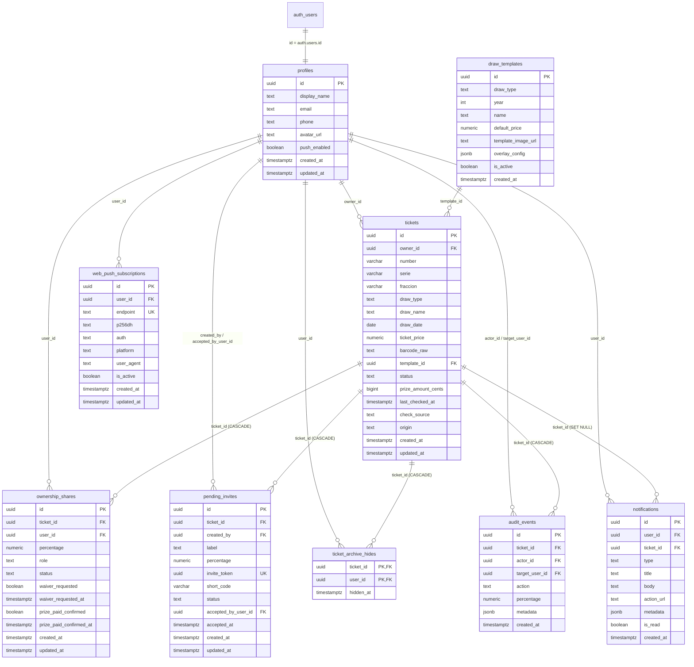

# ARCHITECTURE.md — Arquitectura Técnica de MisDecimos

Documento de referencia para el modelo de datos, funciones transaccionales y subsistemas de MisDecimos.

---

## 1. Diagrama Entidad-Relación (ER)

---

## 2. Catálogo de Funciones RPC (`SECURITY DEFINER`)

Todas las operaciones que mutan porcentajes, estados de décimos o invitaciones se ejecutan de manera atómica con `SET search_path = public, auth`:

| Función RPC | Parámetros Principales | Descripción y Efecto Atómico |
| :--- | :--- | :--- |
| `create_ticket` | `p_number, p_serie, p_fraccion, p_draw_type, p_draw_name, p_draw_date, p_ticket_price, p_barcode_raw, p_template_id, p_origin` | Crea el décimo, asigna cuota del 100% al propietario en `ownership_shares`, registra evento en `audit_events` y genera notificación interna. |
| `create_manual_participation` | `p_ticket_id, p_percentage, p_label` | Valida que el llamante sea el propietario, resta `p_percentage` de su cuota, genera un `short_code` numérico aleatorio único de 6 dígitos y crea el registro en `pending_invites`. |
| `create_equal_split_participations` | `p_ticket_id, p_parts_count, p_owner_participates` | Cancela invitaciones pendientes previas restituyendo cuotas, reparte a partes iguales absorbiendo el redondeo en la cuota del propietario y genera las invitaciones pendientes. |
| `cancel_pending_invite` | `p_invite_id` | Cambia el estado de la invitación a `CANCELADA` y reintegra íntegramente su porcentaje al propietario. |
| `accept_pending_invite` | `p_code_or_token, p_confirm` | Con `p_confirm = false` retorna una vista previa informativa. Con `p_confirm = true`, transfiere la cuota a `ownership_shares` (`ACEPTADA`) a nombre del usuario autenticado, marca la invitación `ACEPTADA` y notifica al propietario. |
| `reject_pending_invite` | `p_code_or_token` | Marca la invitación como `RECHAZADA` y restituye el porcentaje de forma inmediata al propietario. |
| `request_share_waiver` | `p_share_id` | Solo el propietario. Establece `waiver_requested = true` y despacha una notificación de solicitud de renuncia al participante. |
| `respond_share_waiver` | `p_share_id, p_accept` | El participante responde. Si acepta, su cuota pasa a 0%, estado `RENUNCIADA`, y el porcentaje se le devuelve al propietario. Si rechaza, cancela la solicitud manteniendo la cuota. |
| `renounce_own_participation` | `p_share_id` | Permite al participante con cuota aceptada renunciar voluntariamente a ella mientras no esté liquidado ni premiado pendiente. Su cuota pasa a 0%, estado `RENUNCIADA`, se reintegra al propietario, genera auditoría `RENUNCIA_VOLUNTARIA_PARTICIPANTE` y notifica al custodio. |
| `record_ticket_prize_check` | `p_ticket_id, p_prize_amount_cents, p_check_source, p_list_status` | Actualiza el premio del billete, marca estado `VALIDADO` si estaba `PENDIENTE`, registra `PREMIO_COMPROBADO` en auditoría y genera alertas con importes proporcionales a cotitulares. |
| `request_payout_confirmation_reminder` | `p_ticket_id` | Permite enviar un recordatorio formal de cobro (`SOLICITUD_VALIDAR_COBRO`) a participantes pendientes o al propietario. |
| `confirm_prize_received` | `p_ticket_id` | El participante o custodio confirma recepción de su cobro. Si todos los cotitulares activos han confirmado, conmuta el estado del décimo a `LIQUIDADO`. |
| `mark_all_notifications_read` | - | Marca de forma masiva todas las notificaciones pendientes del usuario autenticado como leídas (`is_read = true`). |
| `toggle_archive_ticket` | `p_ticket_id, p_archive` | Gestiona el registro en `ticket_archive_hides` para ocultar o desocultar el décimo en la vista del usuario llamante. |

### Políticas de Seguridad y Aislamiento RLS (Row Level Security)

- **`pending_invites` (Privacidad Estricta de Códigos PIN y Tokens):**
  - La política `pending_invites_select` permite el acceso `SELECT` únicamente a:
    1. El propietario del décimo (`created_by = auth.uid() OR is_ticket_owner(ticket_id)`).
    2. El usuario que ya aceptó esa invitación concreta (`accepted_by_user_id = auth.uid()`).
  - Ningún otro participante del décimo (`ownership_shares`) puede consultar ni listar invitaciones en estado `PENDIENTE` ni obtener códigos PIN o tokens por API directa.
  - Las operaciones de previsualización y canje de invitaciones (`accept_pending_invite` y `reject_pending_invite`) operan mediante funciones RPC transaccionales `SECURITY DEFINER` con `search_path = public, auth`, permitiendo validar y canjear códigos PIN de 6 dígitos sin requerir permisos `SELECT` directos sobre la tabla por parte del invitado.

---

## 3. Arquitectura PWA y Web Push VAPID

### Ciclo de Vida y Auto-Actualización Silenciosa (`autoUpdate`)
- **Estrategia Workbox:** `registerType: 'autoUpdate'`, `skipWaiting: true`, `clientsClaim: true` y `cleanupOutdatedCaches: true`.
- **Detección Inmediata y Silenciosa:** La PWA comprueba la existencia de nuevas versiones cada 60 segundos y cada vez que el usuario regresa a la aplicación (`visibilitychange`). Al detectar una nueva compilación en Vercel, descarga los nuevos assets y activa el nuevo Service Worker en segundo plano.
- **Transición Transparente:** Mediante el listener `controllerchange` en el cliente, la aplicación recarga una única vez de forma limpia sin mostrar carteles flotantes ni requerir confirmación manual del usuario, garantizando que siempre se ejecute el código más reciente.
- **Depuración Manual:** El modal de diagnóstico del componente `<VersionBadge />` mantiene la capacidad de inspeccionar el commit, versión y fecha de compilación, además de un botón directo de purga forzada (`navigator.serviceWorker.getRegistrations().unregister()` + borrado de `window.caches`).

### Soporte Multi-Plataforma
- **Android:** Notificaciones Web Push estándar mediante el Service Worker vía Chrome/Edge/Firefox.
- **iOS (16.4+):** Requiere que la aplicación sea instalada en la pantalla de inicio ("Añadir a pantalla de inicio" / PWA standalone) para conceder permisos y suscribirse al Notification API mediante el Service Worker.

### Onboarding Inteligente de Permisos Push (`src/hooks/usePushPermissionPrompt.ts`)
- **Estrategia No Intrusiva:** La solicitud de permisos Web Push se gestiona de forma diferida y contextualizada para maximizar la tasa de aceptación sin saturar al usuario:
  - **Disparador 1 (Primera Visita):** Se abre tras 1,5 segundos en la primera sesión (`dismissals === 0`) si el usuario no tiene permisos activos.
  - **Disparador 2 (Notificación Pendiente):** Se abre de forma contextualizada (*"Tienes notificaciones nuevas"*) si existen alertas no leídas (`unreadCount > 0`) y no se ha preguntado en la sesión actual.
- **Límite de 3 Cancelaciones:** Se almacena el contador `misdecimos_push_prompt_dismissals_${userId}` en `localStorage` con bloqueo de sesión en `sessionStorage`. Si el usuario descarta 3 veces el diálogo o si el navegador tiene el permiso en `denied`, no se vuelve a preguntar de forma automática.
- **Aviso de Descarte:** Al pulsar *"Ahora no"* o cerrar el modal, se muestra un aviso flotante de 5 segundos con acceso directo para gestionar las alertas en **Perfil**. Al activar manualmente el interruptor en `ProfilePage.tsx`, el contador de descartes se restablece automáticamente a 0.

### Instalador y Guía PWA Multiplataforma (`src/hooks/usePwaInstallPrompt.ts` y `<PwaInstallBanner />`)
- **Detección de Entorno Standalone:** Comprueba de forma combinada `display-mode: standalone`, `(navigator as any).standalone === true`, referrers `android-app://` y la persistencia en `localStorage` (`misdecimos_pwa_installed`). Si la app ya está instalada, anula cualquier aviso automático.
- **Detección de Plataforma y Adaptación Visual:**
  - `chromium`: Android (Chrome, Edge, Samsung Internet, Brave) y navegadores de escritorio Chromium. Captura a nivel global el evento `beforeinstallprompt` y escucha `appinstalled`. Dispone del botón directo de instalación en un clic (`deferredPrompt.prompt()`).
  - `ios`: iPhone, iPod e iPadOS (incluyendo iPadOS que reporta `MacIntel` con pantalla multitáctil `maxTouchPoints > 1`). Despliega guía visual con iconos paso a paso: compartir (`Share`) → *"Añadir a pantalla de inicio"* (`PlusSquare`) → *"Añadir"*.
  - `macos-safari`: Safari de escritorio en macOS. Muestra instrucciones guiadas para anclar al Dock mediante *Archivo → Añadir al Dock...*.
  - `desktop-other`: Otros navegadores de escritorio (como Mozilla Firefox). Ofrece orientación para instalar desde la barra de direcciones o menú del navegador.
- **Regla de Frecuencia Estricta (Máximo 3 Apariciones):**
  - Almacena en `localStorage` la clave `misdecimos_pwa_install_prompt_count`.
  - Dispone de bloqueo de sesión en `sessionStorage` (`misdecimos_pwa_prompt_shown_session`) para mostrarlo como máximo una única vez por sesión.
  - Se activa con un retardo de 2,5 segundos tras cargar la app únicamente si no hay modales en primer plano (`PushPermissionModal` o vistas de billete).
  - Al descartar (`dismiss()`), incrementa el contador en `+1`. Cuando alcanza `3`, no vuelve a mostrarse de forma automática jamás.
- **Invocación Manual en Perfil:** La sección *"Instalar aplicación en tu dispositivo"* en `ProfilePage.tsx` permanece siempre accesible e ignora el límite de 3 avisos, abriendo de forma inmediata el instalador correspondiente.
- **Soporte de Navegación Nativa:** Integrado con `useModalBackHandler` (`modalKey: 'pwa_install_banner'`) y presentado a nivel `z-50` sobre `BottomNav` con padding seguro para la barra de inicio (`env(safe-area-inset-bottom)`).

### Navegación Nativa Android y Gestión de Historial (PWA Anti-Cierre)
- **Gestor Global (`src/hooks/useAndroidBackNavigation.ts`):**
  - Controla el evento `window.onpopstate` para sincronizar las vistas internas (`/`, `/billetes/:id`, `/alertas`, `/auditoria`, `/perfil`) con el botón o gesto físico de retroceso de Android sin depender de librerías externas pesadas.
  - **Mecanismo Centinela (`exitGuard: true`):** En la ruta raíz (`/`), se inserta una entrada centinela en la pila de `window.history`. Al pulsar Atrás por primera vez, el evento es interceptado, se muestra un toast flotante en `z-50` (*"Pulsa atrás de nuevo para cerrar la aplicación"*) y se activa una ventana temporal de 2,5 segundos. Si se produce un segundo toque dentro de ese lapso, se permite la salida de la PWA; de lo contrario, el aviso se oculta y la guardia centinela se re-arma de manera automática.
  - **Navegación Interior y Resiliencia Deep-Link:** En pantallas secundarias con historial previo (`idx > 0`), el botón Atrás retrocede de forma natural. Si el usuario ingresó directamente por notificación push o enlace profundo sin historial (`idx === 0`), se redirige de forma transparente a la vista principal `/` en lugar de cerrar la aplicación.
  - **Historial Completo en `BottomNav`:** La navegación entre pestañas no sobrescribe la pila (`replace: true`), permitiendo al usuario volver sobre sus pasos de forma intuitiva.
- **Manejador de Modales y Sheets (`src/hooks/useModalBackHandler.ts`):**
  - Mantiene una pila global de modales activos (`activeModalStack`) y un contador de cierres programáticos (`programmaticBackCount`).
  - Al abrirse cualquier modal (`TicketFormModal`, `CreateParticipationSheet`, `BarcodeScannerModal`, `ShareInviteModal`, `InviteClaimModal`, `PwaInstallBanner`, `VersionBadge`), empuja un estado `{ modalOpen: true, modalKey }` en el historial y se apila en `activeModalStack`.
  - Al recibir `popstate` por pulsación de 'Atrás' físico, solo el modal situado en la cima de la pila responde y se cierra, protegiendo a los modales padre subyacentes.
  - **Prevención de Cierre en Cascada:** Cuando un modal hijo (ej. `BarcodeScannerModal`) se cierra programáticamente por código (tras escanear con éxito o por UI), incrementa `programmaticBackCount` antes de invocar `window.history.back()`, absorbiendo el evento `popstate` y garantizando que el modal padre (`TicketFormModal`) permanezca abierto con los datos precargados.

### Flujo de Suscripción y Envío
1. **Suscripción y Sincronización Silenciosa:** El cliente genera o verifica una suscripción mediante `PushManager.subscribe()` usando la clave pública VAPID expuesta (`VITE_VAPID_PUBLIC_KEY`). En cada arranque de la app o login con `Notification.permission === 'granted'`, `AppShell.tsx` invoca `syncPushSubscription(user.id)` en segundo plano.
2. **Persistencia y RLS:** La suscripción (`endpoint`, `p256dh`, `auth`, `platform`, `user_agent`) se persiste mediante `upsert` en `public.web_push_subscriptions` (con vista alias `public.push_subscriptions`) asociada al usuario autenticado, y se actualiza `profiles.push_enabled = true`.
3. **Trigger Asíncrono en Base de Datos y Deep-Linking:** Al insertarse una notificación en `public.notifications` (por premio, invitación, renuncia o aviso), el trigger PostgreSQL `on_notification_created_send_push` (`trigger_send_push_notification`) extrae `v_ticket_id := coalesce(NEW.ticket_id::text, NEW.metadata->>'ticket_id')` y construye la URL de destino (`/billetes/:id` o fallback `/alertas`). Dispara de forma asíncrona no bloqueante (`pg_net` / `net.http_post`) la Edge Function `send-push` inyectando `ticket_id`, `ticketId`, `notification_id`, `notificationId`, `actionUrl` y las cabeceras `apikey` y `Authorization: Bearer <anon_key>` para superar la autenticación del API Gateway (Kong), omitiendo registros con `type = 'PUSH_TEST'` para prevenir duplicidades.
4. **Despacho VAPID en Edge Function (`send-push` v3):** La Edge Function `send-push` recupera las claves VAPID de los secretos del proyecto (`VAPID_PUBLIC_KEY`, `VAPID_PRIVATE_KEY`, `VAPID_SUBJECT`) y despacha la notificación a todos los dispositivos activos del usuario destinatario mediante `npm:web-push`. Los campos `ticketId`, `ticket_id`, `notificationId` y `notification_id` se integran en el nivel superior y dentro del objeto `data` del payload push. Devuelve un desglose estructurado `{ success, sent, failed, errors, deactivatedCount }` y desactiva de forma automática suscripciones que devuelvan HTTP 404 o 410 (tokens revocados o expirados).
5. **Recepción en Service Worker (`push-sw.js`):** El Service Worker `push-sw.js` (importado por Workbox en el ciclo `generateSW`) intercepta el evento `push`, parsea el payload JSON o fallback a texto plano, y muestra la alerta con `icon: '/pwa-192x192.png'`, `badge: '/pwa-192x192.png'` y el `tag` específico del ticket. Al pulsar la notificación (`notificationclick`), cierra el aviso y:
   - Si la PWA ya está abierta (en primer plano o segundo plano): enfoca la ventana existente (`client.focus()`), emite un evento `postMessage({ type: 'PUSH_NOTIFICATION_CLICK', url, ticketId, notificationId })` para que React navegue inmediatamente sin recargar ni perder estado, y sincroniza la URL con `client.navigate()`.
   - Si la aplicación estaba cerrada (arranque en frío / cold start): invoca `clients.openWindow(resolvedTarget)`.
6. **Mapeo de Rutas y Marcado Silencioso en el Cliente (`AppShell.tsx` y `useAndroidBackNavigation.ts`):** `AppShell.tsx` escucha los mensajes del Service Worker y, ante `PUSH_NOTIFICATION_CLICK`, navega de forma limpia a `ticketId` o la ruta resuelta mediante `parseRouteFromPath()`, marcando en paralelo la notificación como leída en Supabase (`is_read = true`). El hook de historial reconoce rutas y alias `/billetes/:id`, `/billete/:id`, `/decimos/:id`, `/decimo/:id`, `/tickets/:id`, `/ticket/:id` garantizando que tanto en arranque en frío como en navegación interna se abra `TicketDetailPage` de forma inmediata.

---

## 4. Captura GS1-128 y Motor de Plantillas de Boletos

### Parser de Códigos de Barras SELAE (`src/lib/selaeBarcodeParser.ts`) y Clasificador Unificado (`src/lib/scanPayloadClassifier.ts`)

#### Clasificador Polimórfico de Cargas Escaneadas (`scanPayloadClassifier.ts`)
Para solventar la confusión habitual de los usuarios al utilizar el botón rápido de cámara para escanear tanto décimos físicos como códigos QR de invitación, se implementa una capa de clasificación inteligente previa que categoriza de forma pura e instantánea cualquier contenido leído por el escáner:
- **`kind: 'INVITE'`**: Detecta invitaciones en formatos polimórficos:
  - URLs de invitación: `/invite/`, `/invitacion/`, `/claim/`, `/reclamar/`, y parámetros `token`, `code`, `invite`.
  - Códigos UUID estándar (v4/v1).
  - Códigos PIN alfanuméricos de 6 caracteres (mayúsculas y números legibles sin `0/O`, `1/I`).
  - Cargas útiles JSON con propiedades `inviteCode`, `token`, `pin` o `code`.
- **`kind: 'TICKET'`**: Detecta décimos de Lotería Nacional:
  - Estructura SELAE oficial canónica de 20 dígitos (`1 + 3 + 1 + 2 + 3 + 6 + 4`: juego `5` + sorteo `102`/`002` + año + fracción + serie + número + control) decodificada con confianza alta y autodetección de sorteo y fecha por `parseSelaeBarcode`.
  - Números de 5 dígitos introducidos o escaneados directamente.
- **`kind: 'UNKNOWN'`**: Ante códigos o URLs ajenas, retorna un error comprensible y activa un aviso no intrusivo en el visor de cámara sin interrumpir el flujo del usuario.

#### Visor Unificado y Enrutamiento Multimodal (`BarcodeScannerModal.tsx`)
- Habilitación concurrente de simbologías 1D y 2D (`CODE_128`, `ITF`, `EAN_13`, `CODE_39`, `QR_CODE`) tanto en captura de vídeo en directo como en decodificación de fotos estáticas desde la galería.
- Visor con guía unificada rectangular (`270 x 160 px`) y láser de barrido animado para capturar con igual comodidad códigos de barras horizontales o códigos QR.
- Banner de aviso flotante (`warningMsg`) temporal (3,5 segundos) ante códigos no reconocidos, manteniendo el visor activo sin cerrar el modal.
- Enrutamiento automático: si se lee un QR de invitación desde el botón rápido de cámara, se redirige de inmediato a `InviteClaimModal` con previsualización reactiva; si se lee un código de barras de décimo desde el escáner de invitaciones, se conmuta limpiamente a `TicketFormModal` precargando los datos del décimo.
- **Ciclo de Vida Resiliente y Recuperación en Segundo Plano:**
  - Estabilización estricta mediante `useRef` de los callbacks externos (`onScanSuccessRef`, `onCloseRef`) para que el ciclo de vida del hardware dependa exclusivamente de `isOpen`, eliminando reinicios espurios al mover el dispositivo, reorientar la pantalla o recibir re-renders del padre.
  - Control de concurrencia mediante `sessionGenerationRef` e `isTransitioningRef` para evitar colisiones ante peticiones simultáneas de montaje/desmontaje.
  - **Limpieza Profunda del Sensor (`forceReleaseCamera`):** Parada y limpieza de la instancia `Html5Qrcode` combinada con la iteración exhaustiva sobre los elementos `<video>` en el DOM para detener forzosamente todas las pistas `MediaStreamTrack` (`track.stop()`) y desacoplar `srcObject`, liberando el sensor de cámara en Android al 100%.
  - **Gestión de `visibilitychange`:**
    - Al pasar a segundo plano (`document.visibilityState === 'hidden'`), se ejecuta `forceReleaseCamera()` de forma silenciosa para ceder el sensor al sistema operativo.
    - Al regresar a primer plano (`document.visibilityState === 'visible'`), se espera 350 ms para permitir la reasignación de hardware y se relanza una sesión limpia de escaneo de forma transparente.
  - **Supervisión de Pistas de Hardware (`track.onended` / `track.onmute`):** Suscripción a eventos de interrupción en las pistas de vídeo activas para detectar si el sistema operativo cortó el flujo, relanzando la cámara automáticamente.
  - **Reintentos Inteligentes y Diagnóstico Visual:** Hasta 2 reintentos con intervalo de 450 ms ante errores transitorios de hardware (`NotReadableError`, `AbortError`). Ocultación del visor de vídeo congelado ante errores y botón *"Reintentar cámara"* con liberación previa garantizada.

- **Estructura Estándar Oficial Definitiva (20 Dígitos: `1 + 3 + 1 + 2 + 3 + 6 + 4`):** Normaliza y decodifica con precisión matemática la secuencia numérica canónica presente en los billetes físicos de Lotería Nacional (Code-128, GS1-128, ITF):

| Segmento | Longitud | Posiciones | Campo decodificado | Ejemplo 1 (`5102502115>0493073567`) | Ejemplo 2 (`5002001002>0880082456`) | Ejemplo 3 (`5102607065>0023205830`) |
| :--- | :---: | :---: | :--- | :--- | :--- | :--- |
| **Juego** | 1 | 0..1 | Identificador SELAE Lotería Nacional (`5`) | `5` | `5` | `5` |
| **Código Sorteo** | 3 | 1..4 | `drawCode` (`102` = Navidad, `002` = El Niño) | `102` (Navidad) | `002` (El Niño) | `102` (Navidad) |
| **Dígito Año** | 1 | 4..5 | `yearDigit` (`fullYear = 2020 + Number(d)`) | `5` → **`2025`** | `0` → **`2020`** | `6` → **`2026`** |
| **Fracción** | 2 | 5..7 | `fraction` / `fraccion` | `02` (Fracción 2ª) | `01` (Fracción 1ª) | `07` (Fracción 7ª) |
| **Serie** | 3 | 7..10 | `series` / `serie` | `115` (Serie 115ª) | `002` (Serie 2ª) | `065` (Serie 65ª) |
| **Número (6 dígitos)** | 6 | 10..16 | `ticketNumber` (`match[5].slice(-5)`) | `049307` → **`49307`** | `088008` → **`88008`** | `002320` → **`02320`** |
| **Control** | 4 | 16..20 | `checkDigits` | `3567` | `2456` | `5830` |

- **Expresión Regular Canónica:** `/(?:01)?5(\d{3})(\d{1})(\d{2})(\d{3})(\d{6})(\d{4})/` admitiendo opcionalmente prefijo GS1 `01` y con fallback de 20 dígitos genéricos `^(\d{1})(\d{3})(\d{1})(\d{2})(\d{3})(\d{6})(\d{4})$`.
- **Autodetección de Tipo y Fecha de Sorteo:**
  - `drawCode === '102'`: Determina automáticamente `drawType = 'NAVIDAD'`, `drawDate = `${fullYear}-12-22`` y `drawName = `Sorteo Extraordinario de Navidad ${fullYear}``.
  - `drawCode === '002'`: Determina automáticamente `drawType = 'EL_NINO'`, `drawDate = `${fullYear}-01-06`` y `drawName = `Sorteo Extraordinario de El Niño ${fullYear}``.
  - Otros sorteos ordinarios: Preserva `drawCode` y `year`, asignando fallback sin bloquear el formulario.
- **Normalización y Resiliencia OCR:** Eliminación previa de cualquier carácter no numérico (`raw.replace(/\D/g, '')`), incluyendo separadores como `>` y prefijos de simbología GS1 (ej. `]C1`), y sustitución de confusiones de caracteres comunes (`O->0`, `I/L->1`, `Z->2`, `S->5`, `B->8`).
- **Compatibilidad de Nombres:** Retorna aliases duales (`number`/`ticketNumber`, `serie`/`series`, `fraccion`/`fraction`, `drawCode`/`drawYearCode`).
- **Seguridad e Integridad:** Ante códigos ajenos a SELAE o no reconocidos, devuelve `isValid: false` y mensaje explicativo en `errorMessage`, sin inventar números ni recurrir a valores hardcoded ficticios.

### Motor de Renderizado Híbrido (`<RealisticTicketCard />`)
- **Modo Plantilla Oficial (`draw_templates`):** Cuando existe una plantilla oficial registrada en la base de datos con `template_image_url`, superpone dinámicamente el número registrado, serie, fracción, fecha e importe según las coordenadas porcentuales de `overlay_config`.
- **Modo Vectorial Realista:** Si no se dispone de imagen externa, genera una réplica fotorrealista en SVG/CSS del boleto nacional:
  - Trama guilloche geométrica decorativa en verde lotería `#2E6146` y oro `#D97706`.
  - Capilla artística con el sello oficial **MisDecimos · SELLO DIGITAL**.
  - Tipografía matricial monoespaciada emulando la imprenta de la Fábrica Nacional de Moneda y Timbre (FNMT).
  - Código de barras GS1-128 simulado con checksum visible en la base.

---

## 5. Motor de Comprobación Oficial y Edge Function `check-prizes`

### Arquitectura Híbrida de 3 Niveles (3-Tier Hybrid Architecture)
Debido a que `loteriasyapuestas.es` bloquea peticiones server-side con código HTTP 403 (Akamai Bot Manager) y `api.elpais.com` solo cubre la edición en curso devolviendo `busqueda={"error":1}` fuera de temporada sin archivo histórico, `check-prizes` implementa una arquitectura híbrida de 3 niveles:

1. **Nivel 1 — Simulación Controlada (Entorno de Pruebas):**
   - Exclusivo para el propietario custodio del décimo (`simulatedPrizePerDecimo` / `resetSimulation`).
   - Permite verificar el comportamiento de la UI, el cálculo de cuotas y las notificaciones en cualquier momento.
2. **Nivel 2 — Motor Histórico Oficial Integrado (2020–2025):**
   - Base de datos histórica oficial (`historicalDraws.ts`) con todos los sorteos de **Lotería de Navidad** (22 de diciembre) y **Sorteo de El Niño** (6 de enero) desde 2020 hasta 2025 inclusive.
   - Evaluación matemática oficial (`evaluateHistoricalDraw`):
     - **Premios mayores:** El Gordo / 1.º premio, 2.º premio, 3.º premio, 4.º premios (Navidad), 5.º premios (Navidad).
     - **Aproximaciones:** Número anterior y posterior (±1) al 1.º premio (2.000 € en Navidad, 1.200 € en El Niño) y al 2.º premio (1.250 € en Navidad, 610 € en El Niño).
     - **Centenas:** Coincidencia en las tres primeras cifras con los premios mayores (100 € por décimo).
     - **Terminaciones (Últimas cifras):** Coincidencia en las 2 últimas cifras del 1.º, 2.º y 3.º premio (100 € en Navidad); extracciones de 4 cifras (350 €), 3 cifras (100 €) y 2 cifras (40 €) en El Niño.
     - **Reintegros:** Última cifra del Gordo (20 € en Navidad); 3 reintegros oficiales (20 € en El Niño).
   - Invocación atómica a `record_ticket_prize_check` con `p_check_source = 'historico_oficial'`, actualización de `status = 'VALIDADO'`, inserción en `audit_events` y despacho de Web Push a cotitulares.
3. **Nivel 3 — Sorteos en Directo y Futuros (2026+):**
   - **Sorteos Futuros (`draw_date > today` o antes de la hora peninsular oficial):** Devuelve `{ ok: false, code: 'DRAW_NOT_HELD_YET', message: 'Este sorteo se celebrará el DD/MM/AAAA. Aún no hay resultados oficiales.' }`.
   - **Sorteo en Directo (`draw_date === today`):** Consulta a `api.elpais.com` (`NAVIDAD` y `EL_NINO`). Si está en escrutinio (`status === 0`), devuelve `DRAW_IN_PROGRESS`.
   - **Sorteos Pasados no Soportados:** Si el sorteo no figura en el histórico ni en el proveedor activo, devuelve `{ ok: false, code: 'HISTORICAL_UNAVAILABLE' }`.

### Estrategia de Caché y Persistencia Atómica
- **Caché en Memoria (Edge Runtime):** Map con clave `${drawDate}:${drawType}:${number}` para aislar sorteos del mismo número en diferentes años. TTL de 24 horas para resultados finales (`listStatus === 'final'`) y 5 minutos para listas provisionales durante la celebración del sorteo.
- **Refresco Forzado (`forceRefresh`):** Bypasea la caché cuando el usuario pulsa *"Comprobar de nuevo"*.
- **Persistencia Transaccional:** La Edge Function invoca la RPC `record_ticket_prize_check` con la cabecera `Authorization` del llamante, garantizando RLS estricto e inserción inmutable de auditoría.

---

## 6. Sistema de Identidad Visual y Assets PWA / Mobile

### Especificación de Marca y Composición del Isotipo
La identidad gráfica de **MisDecimos** evoluciona hacia una estética de orfebrería y numismática de alta seguridad inspirada en los billetes de lotería tradicionales y los sellos de la Fábrica Nacional de Moneda y Timbre (FNMT):
- **Contenedor Squircle Superelíptico (`n = 4.70`):** Gradiente verde esmeralda profundo (`#2E6146` a `#183E2C`) con micro-bisel superior de luz.
- **Medallón de Orfebrería Perimetral:** Doble anillo exterior dorado con guilloché de eslabones y cenefas de seguridad concéntricas.
- **Boleto Troquelado en Forma de 'D':** Cuerpo en degradado ámbar/oro (`#F59E0B` a `#C2410C`) con troquelado de perforaciones semicirculares en su margen izquierdo (matriz de billete de lotería) y dientes de engranaje en su arco derecho.
- **Rosa de los Vientos / Estrella Náutica de 4 Puntas:** Emblema central facetado en relieve tridimensional (`#FFFFFF`, `#FEF3C7`, `#F59E0B`, `#78350F`) simbolizando la buena fortuna y la guía en la custodia compartida.

### Catálogo de Recursos de Marca (`public/`)
| Archivo | Dimensiones / Formato | Propósito y Tratamiento Específico |
| :--- | :---: | :--- |
| `pwa-192x192.png` | `192x192 px` · PNG (RGBA) | Icono primario PWA, isotipo de cabecera en `AppShell.tsx`, emblema en `LoginPage.tsx` e icono de notificación Web Push en Android. Incluye esquinas transparentes antialiased. |
| `pwa-512x512.png` | `512x512 px` · PNG (RGBA) | Icono de alta definición para el manifiesto PWA, splash screen y lanzadores de escritorio. |
| `apple-touch-icon.png` | `180x180 px` · PNG (RGB) | Icono específico para iOS Safari / iPadOS. Fondo verde esmeralda sólido (`#22573F`) en las 4 esquinas para evitar que el renderizador de SpringBoard rellene transparencias con negro. |
| `favicon.ico` | Multi-tamaño (`16`, `32`, `48`, `64 px`) · ICO | Favicon clásico para pestañas y marcadores en navegadores de escritorio (Windows, macOS, Linux) con realce de contraste. |
| `favicon.svg` | Vectorial escalable · SVG | Favicon moderno para navegadores compatibles con visualización nítida a cualquier factor de escala y densidad Retina. |
| `masked-icon.svg` | Vectorial monocromo · SVG | Máscara de un solo canal en negro (#000000) requerida por Safari para Pinned Tabs en macOS. |
| `badge-mono.png` | `192x192 px` · PNG (Alpha) | Plantilla monocroma de silueta para la barra de estado de notificaciones en Android 5+. |

