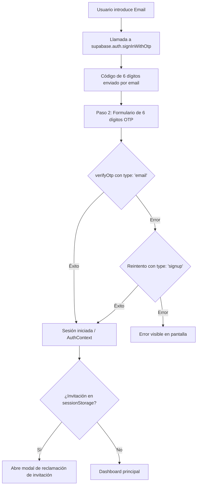

# 📱 Manual Funcional de Pantallas y Flujos de Usuario — MisDecimos

Este documento proporciona una guía detallada y exhaustiva sobre el funcionamiento, propósitos, controles interactivos y código fuente de cada pantalla, modal y flujo dentro de **MisDecimos**.

---

## 📑 Índice de Pantallas

1. [Acceso y Autenticación (Login)](#1-acceso-y-autenticación)
2. [Estructura Base y Navegación (AppShell)](#2-estructura-base-y-navegación)
3. [Dashboard Principal: Mis Billetes Compartidos](#3-dashboard-principal-mis-billetes-compartidos)
4. [Detalle del Décimo y Gestión de Cuotas](#4-detalle-del-décimo-y-gestión-de-cuotas)
5. [Bandeja de Alertas y Notificaciones](#5-bandeja-de-alertas-y-notificaciones)
6. [Centro Global de Auditoría y Trazabilidad](#6-centro-global-de-auditoría-y-trazabilidad)
7. [Mi Perfil, PWA y Ajustes](#7-mi-perfil-pwa-y-ajustes)

---

## 1. Acceso y Autenticación

- **Componente Principal:** [`src/pages/LoginPage.tsx`](../src/pages/LoginPage.tsx)
- **Contexto de Estado:** [`src/context/AuthContext.tsx`](../src/context/AuthContext.tsx)
- **Librería de Backend:** Supabase Auth (`auth.signInWithOtp`, `auth.verifyOtp`)

### Funcionalidad y Controles:
1. **Introducción de Correo Electrónico:**
   - Valida el formato del email y ejecuta `signInWithOtp({ email, options: { shouldCreateUser: true } })`.
   - Si la URL de entrada contiene un parámetro de invitación `?invite=TOKEN` o `/invite/:token`, [`AuthContext.tsx`](../src/context/AuthContext.tsx) lo persiste en `sessionStorage` (`pending_invite_token`) para reanudar la reclamación inmediatamente tras autenticarse.
2. **Entrada de Código OTP de 6 Dígitos:**
   - 6 inputs numéricos independientes con avance y retroceso automático de cursor (`focus`), soporte completo para pegar (*paste*) un código de 6 dígitos copiado del portapapeles.
   - **Mecanismo de Doble Verificación Anti-Fallo:** Se invoca `supabase.auth.verifyOtp` con `type: 'email'`. Si Supabase rechaza la petición porque el usuario es un registro nuevo no confirmado, se reintenta automáticamente con `type: 'signup'`.
3. **Temporizador de Reenvío:**
   - Cuenta atrás regresiva de 60 segundos antes de permitir reenviar el código.
   - Botón *"Cambiar correo"* para retroceder de paso en caso de errata.
4. **Pie de Página Dinámico:**
   - Muestra la versión real en ejecución `MisDecimos v${__APP_VERSION__}` enlazada a la constante de compilación.

---

## 2. Estructura Base y Navegación

- **Componente Contenedor:** [`src/components/layout/AppShell.tsx`](../src/components/layout/AppShell.tsx)
- **Badge Anti-Caché:** [`src/components/common/VersionBadge.tsx`](../src/components/common/VersionBadge.tsx)

### Elementos de la Interfaz:
1. **Cabecera Superior Fija:**
   - **Logo y Título:** Logotipo oficial de Loterías y marca MisDecimos.
   - **Botón de Campana de Alertas:** Acceso directo a la pestaña de notificaciones con insignia numérica roja en tiempo real si existen alertas no leídas.
   - **Avatar de Usuario:** Enlace rápido al perfil del usuario autenticado.
6. **Barra Inferior Móvil (`BottomNav`):**
   - 4 accesos fijos adaptados a pantallas táctiles (con capa base `z-30` para permanecer siempre por debajo de cualquier modal o bottom sheet `z-50`):
     - 🎟️ **Billetes:** Dashboard de décimos en custodia y participaciones.
     - 🔔 **Alertas:** Centro de notificaciones con badge interactivo.
     - 🛡️ **Auditoría:** Registro global de operaciones inmutables.
     - 👤 **Perfil:** Configuración de cuenta, avatar y notificaciones Web Push.
   - **Historial Completo de Navegación:** El cambio de pestaña añade entradas al historial de navegación (sin `replace: true`), permitiendo que el botón o gesto "Atrás" de Android regrese naturalmente a la vista anterior.
3. **Gestión del Botón Atrás de Android y Protección contra Cierre PWA (`useAndroidBackNavigation` y `useModalBackHandler`):**
   - **Cierre Natural de Modales y Sheets:** Al abrir cualquier diálogo (`TicketFormModal`, `CreateParticipationSheet`, `BarcodeScannerModal`, `ShareInviteModal`, `InviteClaimModal` o el modal de `<VersionBadge />`), pulsar el botón Atrás cierra limpiamente el modal sin abandonar la pantalla actual ni cerrar la aplicación.
   - **Navegación Interior:** En pantallas secundarias (`/alertas`, `/auditoria`, `/perfil`, `/billetes/:id`), pulsar Atrás regresa a la pantalla previa. Si se accedió por enlace profundo o notificación sin historial (`idx === 0`), redirige a la raíz `/` en vez de cerrar la PWA.
   - **Guardia Centinela en Ruta Raíz y Confirmación Doble Tap:** En la vista principal (`/`), el primer toque de Atrás muestra un toast flotante (`z-50`, encima de `BottomNav`): *"Pulsa atrás de nuevo para cerrar la aplicación"*. Si se pulsa de nuevo en menos de 2,5 segundos, la aplicación se cierra; si no, el aviso desaparece y la protección se rearma automáticamente.
4. **Componente `<VersionBadge />`:**
   - Widget flotante discreto en la esquina inferior que muestra `vX.Y.Z · <git-hash>` y el indicador de red (*Online/Offline*).
   - Al pulsar, abre un modal de diagnóstico técnico con la fecha de build y el botón *"Forzar actualización y limpiar caché"*, que vacía `caches`, desregistra Service Workers y recarga en limpio.
   - **Ciclo de vida `autoUpdate` silencioso:** El Service Worker descarga y activa inmediatamente las nuevas versiones en segundo plano (`skipWaiting: true`, `clientsClaim: true`) y recarga la interfaz una sola vez de forma limpia sin requerir confirmación del usuario ni mostrar carteles flotantes molestos. Comprueba actualizaciones cada 60 segundos y cada vez que el usuario regresa a la pestaña (`visibilitychange`).

---

## 3. Dashboard Principal: Mis Billetes Compartidos

- **Página:** [`src/pages/TicketsPage.tsx`](../src/pages/TicketsPage.tsx)
- **Tarjeta de Listado:** [`src/components/tickets/TicketListItemCard.tsx`](../src/components/tickets/TicketListItemCard.tsx)
- **Modal de Registro:** [`src/components/tickets/TicketFormModal.tsx`](../src/components/tickets/TicketFormModal.tsx)
- **Escáner de Código de Barras / QR:** [`src/components/tickets/BarcodeScannerModal.tsx`](../src/components/tickets/BarcodeScannerModal.tsx)
- **Parser Oficial GS1-128:** [`src/lib/selaeBarcodeParser.ts`](../src/lib/selaeBarcodeParser.ts)
- **Modal de Reclamación:** [`src/components/tickets/InviteClaimModal.tsx`](../src/components/tickets/InviteClaimModal.tsx)

### Pestañas del Dashboard:
- **Mis Décimos:** Muestra los décimos donde el usuario actual es el custodio legal y propietario registrador (`owner_id = user.id`).
- **Mis Participaciones:** Muestra los décimos donde el usuario ha sido invitado y posee una cuota activa aceptada (`percentage > 0`).
- **Archivados:** Décimos ocultados o archivados por el usuario para limpiar su vista principal.

### Botones y Acciones:
1. **Fila "Añadir un Décimo" (Botón Principal Manual + Botón Rápido de Cámara):**
   - **Botón Principal Manual (`Añadir décimo manual`):** Con fondo blanco, borde doble verde corporativo (`#2E6146`), altura táctil ergonómica (`min-h-[54px]`) e icono de billete (`Ticket`), abre [`TicketFormModal.tsx`](../src/components/tickets/TicketFormModal.tsx) directamente en la pestaña de **Datos Manuales** (`initialTab="manual"`), permitiendo seleccionar sorteo (**Navidad** o **El Niño**), número (5 dígitos), serie y fracción.
   - **Botón Cuadrado Verde de Cámara (Acceso Directo):** Con tamaño idéntico de 54x54 px (`w-[54px] min-h-[54px]`), fondo verde sólido `#2E6146` e icono `Camera` en **blanco puro** de 24 px (`size={24}`, `strokeWidth={2.2}`), abre de forma instantánea la cámara trasera del dispositivo (`initialTab="scanner"` activando [`BarcodeScannerModal.tsx`](../src/components/tickets/BarcodeScannerModal.tsx) en modo GS1-128). Al detectar el código oficial del décimo físico, rellena automáticamente los datos y los presenta en pantalla para confirmación y guardado.
   - Al guardar, ejecuta la RPC transaccional `create_ticket`, asegurando el 100% de titularidad inicial y navegando inmediatamente a la ficha de detalle.
2. **Botón "Reclamar / Canjear Código" (o QR):**
   - Abre [`InviteClaimModal.tsx`](../src/components/tickets/InviteClaimModal.tsx).
   - Permite introducir el código de 6 dígitos o escanear el código QR recibido por WhatsApp/email.
   - Realiza una previsualización de la participación (número, sorteo, porcentaje e importe en €) y ofrece dos opciones:
     - **"Aceptar y Asignar a mi cuenta":** Ejecuta `accept_pending_invite` y transfiere formalmente la cuota.
     - **"Rechazar Participación":** Reintegra de inmediato el porcentaje al propietario.

---

## 4. Detalle del Décimo y Gestión de Cuotas

- **Página Principal:** [`src/pages/TicketDetailPage.tsx`](../src/pages/TicketDetailPage.tsx)
- **Boleto Realista:** [`src/components/tickets/RealisticTicketCard.tsx`](../src/components/tickets/RealisticTicketCard.tsx)
- **Comprobación de Premios:** [`src/components/tickets/PrizeCheckCard.tsx`](../src/components/tickets/PrizeCheckCard.tsx)
- **Cuadro de Propiedad:** [`src/components/tickets/OwnershipBreakdownCard.tsx`](../src/components/tickets/OwnershipBreakdownCard.tsx)
- **Reparto y Participaciones:** [`src/components/tickets/CreateParticipationSheet.tsx`](../src/components/tickets/CreateParticipationSheet.tsx)
- **Modal de Compartición (QR / Link / WhatsApp):** [`src/components/tickets/ShareInviteModal.tsx`](../src/components/tickets/ShareInviteModal.tsx)
- **Línea Temporal de Auditoría:** [`src/components/tickets/TicketAuditTimeline.tsx`](../src/components/tickets/TicketAuditTimeline.tsx)

### Módulos Integrados en el Detalle:

#### A) Tarjeta de Décimo Realista (`<RealisticTicketCard />`)
- Representación visual del décimo con diseño fiel al papel oficial de SELAE, textura guilloché de seguridad, código de barras simulado, fecha del sorteo, precio e insignia de custodia legal asignada al propietario.
- **Mecanismo de Fallback Anti-Imagen Rota:** Integra un listener reactivo `onError` que, ante cualquier fallo de carga o ausencia de imagen de plantilla externa (`template_image_url`), conmuta de forma automática e inmediata al motor vectorial completo (filigrana guilloché, capilla artística con sello digital `MisDecimos`, número matricial y código GS1-128), evitando iconos de imagen rota en el navegador.

#### B) Comprobador Oficial de Premios (`<PrizeCheckCard />`)
- **Bloqueo Previo al Sorteo y Tarjeta Informativa:** Si la fecha y hora oficial de inicio del sorteo aún no ha llegado en horario peninsular español (`Europe/Madrid` CET: 22 de diciembre a las 09:00 para Navidad, 6 de enero a las 12:00 para El Niño):
  - El botón principal aparece deshabilitado mostrando el icono `CalendarClock` y el texto *"Disponible el DD/MM/YYYY"*, previniendo peticiones prematuras a la Edge Function.
  - Se sustituye el recuadro de resultados por una tarjeta informativa ámbar con icono `CalendarClock`: *"El sorteo aún no se ha realizado. Se celebrará el [fecha] (faltan X días). Podrás comprobar si tiene premio a partir de ese día."*
- **Consulta Oficial Post-Sorteo:** Una vez iniciado el sorteo, el botón *"Comprobar premio"* (o *"Comprobar de nuevo"*) invoca la Supabase Edge Function `check-prizes`, conectada a endpoints oficiales de alta disponibilidad de El País / SELAE.
- **Desglose Fiscal (Ley 16/2012):** Calcula automáticamente el premio total, la exención de los primeros 40.000 € y la retención del 20% de IRPF para obtener el importe neto a liquidar.
- **Cuota Individual:** Muestra a cada participante el importe exacto bruto y neto que le corresponde en base a su porcentaje aceptado.
- **Confirmación de Cobro:** Botón *"He recibido mi premio"*, disponible para cotitulares cuando el estado es `VALIDADO`. Ejecuta `confirm_prize_paid` registrando fecha, hora e IP para la liquidación formal unánime.

#### C) Cuadro de Propiedad y Gráfico Donut SVG (`<OwnershipBreakdownCard />`)
- **Gráfico Donut SVG Dinámico:** Visualiza el 100% de la propiedad dividido en sectores de color por cotitular. En el centro certifica el estado `100% Distribuido` (Principio Cero Huérfanos).
- **Lista de Cotitulares:** Nombre, avatar, porcentaje exacto, importe jugado y estado de cuota (`ACEPTADA`).
  - **Menú Contextual Flotante (`...`):** En estado `PENDIENTE` del décimo, el propietario dispone del botón de opciones (`MoreVertical`) con menú contextual desbloqueado (`z-30`/`z-40` libre de recortes por `overflow`), área táctil cómoda (`py-2.5 px-3.5`) y auto-cierre al pulsar fuera (`mousedown`/`touchstart`) para iniciar el flujo de solicitud de renuncia de participación.
- **Invitaciones Pendientes:** Listado de códigos activos emitidos aún no reclamados, con botón para abrir el modal de compartición y botón **"Eliminar"** visible para el propietario en cualquier estado del décimo (`PENDIENTE`, `VALIDADO`, `ARCHIVADO`, salvo liquidado), devolviendo de inmediato la cuota al propietario. Si existen 2 o más invitaciones pendientes, muestra además el botón masivo **"Cancelar todas las pendientes (recuperar X%)"** para cancelar en un solo clic mediante la RPC `cancel_all_pending_invites`.
- **Añadir Participación y Eliminación de Décimo:** El botón inferior *"Añadir participación"* permanece disponible tanto en `PENDIENTE` como en `VALIDADO` mientras el propietario conserve cuota libre. Asimismo, el botón *"Eliminar décimo"* está habilitado en ambos estados siempre que no existan cuotas de terceros en estado `ACEPTADA`.
- **Flujo Bilateral de Renuncia de Participaciones:**
  - Un participante puede pulsar *"Solicitar renuncia"* indicando el motivo.
  - El custodio recibe una alerta y puede *"Aceptar renuncia"* (reintegrando el porcentaje a su bolsa) o *"Rechazar renuncia"*.

#### D) Reparto de Participaciones (`<CreateParticipationSheet />`)
- **Arquitectura Móvil Flex con Scroll Interno y Pie Fijo:**
  - Contenedor con altura dinámica `max-h-[88dvh]` y capa `z-50` que cubre por completo tanto la cabecera como la barra de navegación inferior (`BottomNav`).
  - **Cabecera fija (`shrink-0`):** Muestra el título *"Nueva Participación"*, el porcentaje disponible en tiempo real y el botón de cierre (`X`).
  - **Cuerpo con scroll (`flex-1 overflow-y-auto overscroll-contain`):** Contiene el selector de modo, stepper de partes o slider de porcentaje, e información matemática sin desbordar la pantalla en navegadores móviles (Chrome/Safari).
  - **Pie fijo de acción (`shrink-0` con `env(safe-area-inset-bottom)`):** Botón verde de confirmación siempre accesible y anclado en la parte inferior sobre la zona segura de dispositivos iOS y Android.
- Permite crear nuevas participaciones antes del sorteo con selector de pestañas reordenado:
  - **Pestaña por defecto:** Abre automáticamente en **"Partes iguales"** (primera pestaña, izquierda) cuando el custodio conserva el 100% de la cuota y no existen participaciones previas; si ya existen participaciones parciales, selecciona automáticamente **"Porcentaje manual"** (segunda pestaña, derecha) con un valor predeterminado del 20% (o el máximo disponible).
  - **Reparto a Partes Iguales:** Entre N personas (ej. 2, 3, 4, 5 cotitulares), aplicando el algoritmo de absorción de redondeo en el custodio para garantizar suma exacta del 100,00%. Genera una bolsa de invitaciones pendientes con un código único de 6 dígitos y enlace para cada cotitular.
  - **Reparto Manual:** Especificando porcentaje (%) o importe en euros (€), con preconfiguración al 20%.
- Al guardar, abre [`ShareInviteModal.tsx`](../src/components/tickets/ShareInviteModal.tsx), que genera:
  - Enlace web directo `https://misdecimos.dianrie.com/invite/<token>`
  - Código numérico de 6 dígitos
  - Código QR generado con `qrcode.react`
  - Botón directo para compartir el mensaje oficial por **WhatsApp**.

#### E) Auditoría del Décimo (`<TicketAuditTimeline />`)
- Historial inmutable y cronológico de todas las mutaciones producidas sobre el décimo: creación, escaneos, cesión de porcentajes, invitaciones reclamadas, renuncias solicitadas/aceptadas y confirmaciones de cobro de premios.

---

## 5. Bandeja de Alertas y Notificaciones

- **Página:** [`src/pages/AlertsPage.tsx`](../src/pages/AlertsPage.tsx)
- **Backend:** Tabla `public.notifications` con suscripción Supabase Realtime y Web Push.

### Funcionalidad y Controles:
1. **Filtro de Estado:** Alternador entre *"Todas las alertas"* y *"Solo no leídas"*.
2. **Formato Temporal:** Estampas temporales formateadas en `HH:mm - DD/MM` (ej. `14:35 - 22/12`).
3. **Acciones Rápidas en la Alerta:**
   - Si la alerta corresponde a una solicitud de renuncia de participación, ofrece directamente dos botones:
     - ✅ **Aceptar Renuncia:** Ejecuta `respond_waiver(..., p_accept = true)`.
     - ❌ **Rechazar:** Ejecuta `respond_waiver(..., p_accept = false)`.
   - Clicar en cualquier alerta redirige automáticamente a la ficha del décimo correspondiente.
4. **Botón "Leídas todas":** Invoca la RPC `mark_all_notifications_read`, actualizando el estado de lectura y poniendo a 0 el badge de la campana.

---

## 6. Centro Global de Auditoría y Trazabilidad

- **Página:** [`src/pages/AuditPage.tsx`](../src/pages/AuditPage.tsx)
- **Backend:** Tabla inmutable `public.audit_events` (sin permisos de UPDATE o DELETE en RLS).

### Secciones Principales:
1. **Acordeón de las 4 Reglas de Oro:**
   - 🔒 **Custodia Inmutable:** El custodio registrador inicial nunca puede transferirse a un tercero.
   - ⚖️ **Cero Huérfanos:** La suma de porcentajes de un décimo debe ser siempre exactamente 100,00%.
   - 🛡️ **Trazabilidad Inmutable:** Cada cesión, renuncia y liquidación se registra con estampa de tiempo y usuario.
   - 🤝 **Liquidación Unánime:** La marcación como `LIQUIDADO` exige que todos los participantes confirmen el cobro.
2. **Buscador y Filtros por Categoría:**
   - Barra de búsqueda libre (número de décimo, tipo de evento o nombre del participante).
   - Chips de filtrado rápido: *Todos, Creación, Participaciones, Premios, Seguridad*.
3. **Línea Temporal Global:**
   - Explorador de eventos de toda la plataforma a los que el usuario tiene acceso legítimo, con tarjeta desplegable de metadatos técnicos (dirección IP, navegador, método de origen y hashes).

---

## 7. Mi Perfil, PWA y Ajustes

- **Página:** [`src/pages/ProfilePage.tsx`](../src/pages/ProfilePage.tsx)
- **Servicio Push:** [`src/services/push/pushSubscription.ts`](../src/services/push/pushSubscription.ts)
- **Banner PWA:** [`src/components/pwa/PwaInstallBanner.tsx`](../src/components/pwa/PwaInstallBanner.tsx)
- **Storage:** Bucket Supabase Storage `avatars` con RLS por UID.

### Opciones y Controles:
1. **Avatar de Usuario con Compresión en Cliente:**
   - Selector de imagen con previsualización inmediata.
   - Redimensiona automáticamente y convierte la imagen a formato **WebP** en el navegador para ahorrar ancho de banda.
   - Sube el archivo al bucket seguro `avatars` en Supabase Storage bajo la carpeta del usuario `auth.uid()`.
2. **Datos Personales Sanitizados:**
   - Campos de *Nombre a mostrar* y *Teléfono de contacto*, protegidos contra inyecciones XSS mediante `sanitizeText`.
3. **Gestión de Notificaciones Web Push (VAPID):**
   - Interruptor (*Toggle*) para activar/desactivar notificaciones nativas en el dispositivo.
   - Registra el endpoint, clave `p256dh` y `auth` en `public.web_push_subscriptions` vinculados al usuario.
   - Botón *"Enviar notificación de prueba"*: Dispara la Edge Function `send-push` en modo test para verificar que el Service Worker y el sistema operativo muestran la alerta correctamente con sonido y vibración.
4. **Instalación de la PWA:**
   - Componente [`PwaInstallBanner.tsx`](../src/components/pwa/PwaInstallBanner.tsx).
   - En Android / Chrome: Dispara el evento nativo `beforeinstallprompt` en un solo clic.
   - En iOS Safari: Guía visual explicativa paso a paso (*"Compartir" -> "Añadir a pantalla de inicio"*).
5. **Cierre de Sesión:**
   - Botón *"Cerrar Sesión"* que ejecuta `supabase.auth.signOut()`, limpia el estado global y devuelve al usuario a la pantalla de Login.
