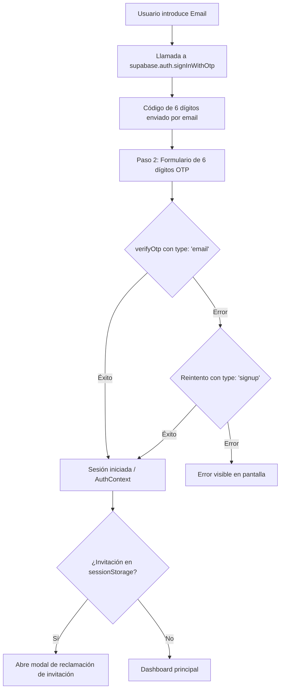

# 📱 Manual Funcional de Pantallas y Flujos de Usuario — MisDecimos

Este documento proporciona una guía detallada y exhaustiva sobre el funcionamiento, propósitos, controles interactivos y código fuente de cada pantalla, modal y flujo dentro de **MisDecimos**.

---

## 📑 Índice de Pantallas

1. [Acceso y Autenticación (Login)](#1-acceso-y-autenticación)
2. [Estructura Base y Navegación (AppShell)](#2-estructura-base-y-navegación)
3. [Dashboard Principal: Mis Billetes Compartidos](#3-dashboard-principal-mis-billetes-compartidos)
4. [Detalle del Décimo y Gestión de Cuotas](#4-detalle-del-décimo-y-gestión-de-cuotas)
5. [Bandeja de Alertas y Notificaciones](#5-bandeja-de-alertas-y-notificaciones)
6. [Centro Global de Auditoría y Trazabilidad](#6-centro-global-de-auditoría-y-trazabilidad)
7. [Mi Perfil, PWA y Ajustes](#7-mi-perfil-pwa-y-ajustes)

---

## 1. Acceso y Autenticación

- **Componente Principal:** [`src/pages/LoginPage.tsx`](../src/pages/LoginPage.tsx)
- **Contexto de Estado:** [`src/context/AuthContext.tsx`](../src/context/AuthContext.tsx)
- **Librería de Backend:** Supabase Auth (`auth.signInWithOtp`, `auth.verifyOtp`)

### Funcionalidad y Controles:
1. **Introducción de Correo Electrónico:**
   - Valida el formato del email y ejecuta `signInWithOtp({ email, options: { shouldCreateUser: true } })`.
   - Si la URL de entrada contiene un parámetro de invitación `?invite=TOKEN` o `/invite/:token`, [`AuthContext.tsx`](../src/context/AuthContext.tsx) lo persiste en `sessionStorage` (`pending_invite_token`) para reanudar la reclamación inmediatamente tras autenticarse.
2. **Entrada de Código OTP de 6 Dígitos:**
   - 6 inputs numéricos independientes con avance y retroceso automático de cursor (`focus`), soporte completo para pegar (*paste*) un código de 6 dígitos copiado del portapapeles.
   - **Mecanismo de Doble Verificación Anti-Fallo:** Se invoca `supabase.auth.verifyOtp` con `type: 'email'`. Si Supabase rechaza la petición porque el usuario es un registro nuevo no confirmado, se reintenta automáticamente con `type: 'signup'`.
3. **Temporizador de Reenvío:**
   - Cuenta atrás regresiva de 60 segundos antes de permitir reenviar el código.
   - Botón *"Cambiar correo"* para retroceder de paso en caso de errata.
4. **Pie de Página Dinámico:**
   - Muestra la versión real en ejecución `MisDecimos v${__APP_VERSION__}` enlazada a la constante de compilación.

---

## 2. Estructura Base y Navegación

- **Componente Contenedor:** [`src/components/layout/AppShell.tsx`](../src/components/layout/AppShell.tsx)
- **Badge Anti-Caché:** [`src/components/common/VersionBadge.tsx`](../src/components/common/VersionBadge.tsx)

### Elementos de la Interfaz:
1. **Cabecera Superior Fija con Safe-Area Dinámica y Navegación Adaptativa:**
   - **Padding y Área Segura:** Padding superior dinámico `pt-[calc(0.875rem+env(safe-area-inset-top))] pb-3.5 px-4 sm:px-6` que garantiza 14 px de aire vertical en escritorio y dispositivos sin notch, y absorbe fluidamente la zona del notch/isla dinámica en iOS y Android sin encajonar el contenido.
   - **Diseño Adaptativo Móvil vs Escritorio:**
     - **Dispositivos Móviles (`< 768px`):** Muestra el bloque interactivo de usuario a la izquierda (avatar circular de 40 px + nombre + correo), navegando a la pantalla de **Perfil** (`/perfil`) con un clic o realizando scroll suave hacia arriba si ya se está en ella, manteniendo las dos secciones principales (**Billetes** y **Alertas**) en la barra inferior para máxima ergonomía táctil.
     - **Navegadores de Escritorio (`>= 768px`):**
       - **Izquierda (Marca e Inicio):** Logotipo corporativo de **MisDecimos** (emblema verde `#2E6146` de 36 px con icono de décimo en blanco) acompañado del nombre de la marca en negrita (`text-lg font-bold tracking-tight text-gray-900`), funcionando como enlace interactivo directo a la pantalla principal (`/`) o scroll hacia arriba si ya se está en ella.
       - **Derecha (Navegación + Perfil):** Menú horizontal integrado con accesos a **Billetes** y **Alertas** (con badge dinámico de notificaciones sin leer), un separador vertical sutil (`h-6 w-px bg-gray-200`) y el botón compacto de usuario (avatar circular de 32 px + nombre de usuario), con indicador activo verde (`bg-[#2E6146]/[0.08] ring-1 ring-[#2E6146]/30`) al navegar a **Perfil** o **Auditoría**.
   - **Centralización de Cierre de Sesión:** El botón de salida se mantiene centralizado en la pantalla de **Perfil** para evitar clics accidentales.
2. **Barra Inferior Móvil (`BottomNav`) Simplificada y Respuesta Responsive:**
   - En dispositivos móviles (`< 768px`), la navegación se realiza mediante la barra fija inferior (`md:hidden`), optimizada para el pulgar con las dos secciones centrales del día a día: **Billetes** y **Alertas** (con badge dinámico en tiempo real).
   - En ordenadores y tabletas (`>= 768px`), la barra inferior se oculta automáticamente y el relleno inferior de la pantalla se reduce (`pb-24 md:pb-10`), posicionando los toasts flotantes de forma ergonómica (`bottom-20 md:bottom-6`).
   - **Historial Completo de Navegación:** El cambio de pestaña añade entradas al historial de navegación (sin `replace: true`), permitiendo que el botón o gesto "Atrás" de Android regrese naturalmente a la vista anterior.
3. **Gestión del Botón Atrás de Android y Protección contra Cierre PWA (`useAndroidBackNavigation` y `useModalBackHandler`):**
   - **Cierre Natural de Modales y Sheets:** Al abrir cualquier diálogo (`TicketFormModal`, `CreateParticipationSheet`, `BarcodeScannerModal`, `ShareInviteModal`, `InviteClaimModal` o el modal de `<VersionBadge />`), pulsar el botón Atrás cierra limpiamente el modal sin abandonar la pantalla actual ni cerrar la aplicación.
   - **Navegación Interior:** En pantallas secundarias (`/alertas`, `/auditoria`, `/perfil`, `/billetes/:id`), pulsar Atrás regresa a la pantalla previa. Si se accedió por enlace profundo o notificación sin historial (`idx === 0`), redirige a la raíz `/` en vez de cerrar la PWA.
   - **Guardia Centinela en Ruta Raíz y Confirmación Doble Tap:** En la vista principal (`/`), el primer toque de Atrás muestra un toast flotante (`z-50`, encima de `BottomNav`): *"Pulsa atrás de nuevo para cerrar la aplicación"*. Si se pulsa de nuevo en menos de 2,5 segundos, la aplicación se cierra; si no, el aviso desaparece y la protección se rearma automáticamente.
4. **Componente `<VersionBadge />`:**
   - Widget flotante discreto en la esquina inferior que muestra `vX.Y.Z · <git-hash>` y el indicador de red (*Online/Offline*).
   - Al pulsar, abre un modal de diagnóstico técnico con la fecha de build y el botón *"Forzar actualización y limpiar caché"*, que vacía `caches`, desregistra Service Workers y recarga en limpio.
   - **Ciclo de vida `autoUpdate` silencioso:** El Service Worker descarga y activa inmediatamente las nuevas versiones en segundo plano (`skipWaiting: true`, `clientsClaim: true`) y recarga la interfaz una sola vez de forma limpia sin requerir confirmación del usuario ni mostrar carteles flotantes molestos. Comprueba actualizaciones cada 60 segundos y cada vez que el usuario regresa a la pestaña (`visibilitychange`).
5. **Onboarding Inteligente de Notificaciones Push (`<PushPermissionModal />` y `usePushPermissionPrompt`):**
   - **Solicitud No Intrusiva:** Dispara un modal adaptado a móvil (`z-50` sobre `BottomNav` con soporte de botón Atrás nativo) tras 1,5 segundos en la primera visita del usuario (`dismissals === 0`) o de forma contextualizada si recibe notificaciones sin leer (`unreadCount > 0`) sin tener el servicio push activado.
   - **Límite de 3 Cancelaciones:** Controla los descartes en `localStorage` por `user.id` con guardias en `sessionStorage` para no repetir preguntas en la misma sesión. Al alcanzar 3 cancelaciones o si el permiso es denegado en el navegador, el sistema no vuelve a solicitarlo de forma automática.
   - **Aviso Informativo con Enlace a Perfil:** Al pulsar *"Ahora no"* o cerrar el modal, se despliega un toast durante 5 segundos informando: *"No recibirás notificaciones push en este dispositivo. Siempre puedes activarlas o desactivarlas en tu Perfil."*, con enlace directo para navegar a `/perfil`.
6. **Instalador y Banner PWA Multiplataforma (`<PwaInstallBanner />` y `usePwaInstallPrompt`):**
   - **Detección Avanzada de Instalación:** Integra comprobación síncrona de modo standalone y asíncrona mediante `navigator.getInstalledRelatedApps()`, apoyado en el Web App Manifest oficial con `"id": "/"` y `"related_applications"`.
   - **Anti-Redundancia en Navegadores Chromium:** En Chrome/Edge/Brave/Samsung Internet, donde el navegador suprime el evento `beforeinstallprompt` si la app ya está instalada, el sistema nunca muestra automáticamente la guía manual de los tres puntos. Solo se activa si `deferredPrompt` está disponible de forma nativa.
   - **Cierre Definitivo en 1 Clic:** Unifica los botones de acción en un botón principal (*«Instalar aplicación»* si hay prompt nativo o *«Entendido»* en guías manuales) acompañado de *«No volver a mostrar»*, guardando de forma permanente en `localStorage` el flag `misdecimos_pwa_prompt_dismissed` para no volver a mostrar el modal de forma automática en ese navegador.

---

## 3. Dashboard Principal: Mis Billetes Compartidos

- **Página:** [`src/pages/TicketsPage.tsx`](../src/pages/TicketsPage.tsx)
- **Tarjeta de Listado:** [`src/components/tickets/TicketListItemCard.tsx`](../src/components/tickets/TicketListItemCard.tsx)
- **Modal de Registro:** [`src/components/tickets/TicketFormModal.tsx`](../src/components/tickets/TicketFormModal.tsx)
- **Escáner de Código de Barras / QR:** [`src/components/tickets/BarcodeScannerModal.tsx`](../src/components/tickets/BarcodeScannerModal.tsx)
- **Parser Oficial GS1-128:** [`src/lib/selaeBarcodeParser.ts`](../src/lib/selaeBarcodeParser.ts)
- **Modal de Reclamación:** [`src/components/tickets/InviteClaimModal.tsx`](../src/components/tickets/InviteClaimModal.tsx)

### Pestañas del Dashboard y Cuadro de Mando:
- **Cuadro de Mando Superior:**
  - **Mis Billetes Compartidos:** Cabecera limpia y minimalista alineada directamente sobre el panel de métricas. El acceso a las notificaciones y su indicador dinámico de no leídas se centralizan exclusivamente en la pestaña fija **Alertas** de la barra de navegación inferior.
  - **Billetes Activos:** Cuenta los billetes propios y participaciones activas aceptadas (`percentage > 0` y `status = 'ACEPTADA'`). Las participaciones a las que el usuario ha renunciado (`status = 'RENUNCIADA'`) quedan estrictamente excluidas de este contador.
  - **Total Premios:** Agrega la parte proporcional ganada por el usuario de los premios en billetes activos propios y participaciones activas aceptadas.
- **Pestañas de Filtrado y Sincronización en URL (`?tab=...`):**
  - **Mis Décimos (`/` o `/?tab=decimos`):** Muestra los décimos donde el usuario actual es el custodio legal y propietario registrador (`owner_id = user.id`).
  - **Mis Participaciones (`/?tab=participaciones`):** Muestra los décimos donde el usuario ha sido invitado y posee una cuota activa aceptada (`status = 'ACEPTADA'` y `percentage > 0`). Las participaciones renunciadas no se muestran aquí.
  - **Archivados (`/?tab=archivados`):** Décimos propios o participaciones activas ocultados o archivados por el usuario para limpiar su vista principal. Las participaciones renunciadas quedan excluidas.
  - **Persistencia de Navegación Bidireccional:** La pestaña activa se sincroniza con `useSearchParams` (`{ replace: true }`) y con `state: { fromTab: activeTab }`. Al abrir la ficha de un décimo y regresar (mediante el botón superior Atrás o el botón físico de Android), la aplicación preserva de forma estricta la pestaña en la que se encontraba el usuario. En aperturas directas sin historial (push/deep-link), el botón superior deriva inteligentemente a `/?tab=participaciones` para cotitulares o a `/` para propietarios.

### Botones y Acciones:
1. **Fila "Añadir un Décimo" (Botón Principal Manual + Botón Rápido de Cámara Polimórfico):**
   - **Botón Principal Manual (`Añadir décimo manual`):** Con fondo blanco, borde doble verde corporativo (`#2E6146`), altura táctil ergonómica (`min-h-[54px]`) e icono de billete (`Ticket`), abre [`TicketFormModal.tsx`](../src/components/tickets/TicketFormModal.tsx) directamente en la pestaña de **Datos Manuales** (`initialTab="manual"`), permitiendo seleccionar sorteo (**Navidad** o **El Niño**), número (5 dígitos), serie y fracción.
   - **Botón Cuadrado Verde de Cámara (Escáner Inteligente Polimórfico):** Con tamaño ergonómico de 54x54 px (`w-[54px] min-h-[54px]`), fondo verde sólido `#2E6146` e icono `Camera` en **blanco puro** de 24 px (`size={24}`, `strokeWidth={2.2}`), abre de forma instantánea la cámara trasera mediante [`BarcodeScannerModal.tsx`](../src/components/tickets/BarcodeScannerModal.tsx) con soporte simultáneo para códigos 1D (SELAE) y 2D (QR de invitaciones).
     - **Enrutamiento y Autocompletado Inteligente:** Si el usuario enfoca un décimo físico de SELAE, el parser descompone la estructura canónica `1 + 3 + 1 + 2 + 3 + 6 + 4` (juego `5`, sorteo `102` Navidad / `002` El Niño, año `2020 + d`, fracción, serie, número de 5 cifras y control), autoselecciona de inmediato el **Tipo de Sorteo** (**Navidad** o **El Niño**), la **Fecha del Sorteo** (`YYYY-12-22` o `YYYY-01-06`), número, serie, fracción y precio oficial (20 €), abriendo [`TicketFormModal.tsx`](../src/components/tickets/TicketFormModal.tsx) en la pestaña `'manual'` con el banner verde esmeralda: *"Código leído correctamente — Verifica los datos antes de guardar"*. Si por el contrario el usuario enfoca un código QR de invitación o participación, el escáner lo detecta de forma inteligente y abre directamente [`InviteClaimModal.tsx`](../src/components/tickets/InviteClaimModal.tsx) con el código precargado y verificado.
     - **Tolerancia y Aviso Inline:** Si se lee un código desconocido, se muestra un aviso visual en la parte superior del visor sin interrumpir la cámara ni cerrar el modal, permitiendo corregir el encuadre.
     - **Recuperación Automática de Segundo Plano (`visibilitychange`):** Al cambiar de aplicación o apagar la pantalla, la cámara libera limpiamente sus pistas para evitar el bloqueo del hardware en Android. Al regresar a la PWA, tras 350 ms de estabilización, el escáner se reactiva automáticamente. Cuenta con hasta 2 reintentos silenciosos ante errores transitorios y oculta el fotograma congelado en caso de requerir intervención del usuario.
   - Al guardar, ejecuta la RPC transaccional `create_ticket`, asegurando el 100% de titularidad inicial y navegando inmediatamente a la ficha de detalle.
2. **Botón "Reclamar / Canjear Código" (o QR):**
   - Abre [`InviteClaimModal.tsx`](../src/components/tickets/InviteClaimModal.tsx).
   - Permite introducir el código de 6 dígitos o escanear el código QR recibido por WhatsApp/email.
   - Realiza una previsualización de la participación (número, sorteo, porcentaje e importe en €) y ofrece dos opciones:
     - **"Aceptar y Asignar a mi cuenta":** Ejecuta `accept_pending_invite` y transfiere formalmente la cuota.
     - **"Rechazar Participación":** Reintegra de inmediato el porcentaje al propietario.
   - **Feedback Instantáneo (0 ms) y Cierre Inmediato:**
     - Al pulsar *"Reclamar X%"* o *"Rechazar participación"*, todos los botones se deshabilitan inmediatamente para evitar dobles pulsaciones y el botón pulsado muestra un spinner con *"Reclamando..."* o *"Rechazando..."*.
     - Al responder con éxito la RPC, el modal se cierra de forma inmediata (`onClose()`) sin retardos artificiales ni pantallas intermedias, lanzando la sincronización en segundo plano (`loadTickets()`) y mostrando un toast verde de confirmación en la pantalla principal: *"¡Participación del X% añadida a tus billetes!"*.

---

## 4. Detalle del Décimo y Gestión de Cuotas

- **Página Principal:** [`src/pages/TicketDetailPage.tsx`](../src/pages/TicketDetailPage.tsx)
- **Boleto Realista:** [`src/components/tickets/RealisticTicketCard.tsx`](../src/components/tickets/RealisticTicketCard.tsx)
- **Comprobación de Premios:** [`src/components/tickets/PrizeCheckCard.tsx`](../src/components/tickets/PrizeCheckCard.tsx)
- **Cuadro de Propiedad:** [`src/components/tickets/OwnershipBreakdownCard.tsx`](../src/components/tickets/OwnershipBreakdownCard.tsx)
- **Reparto y Participaciones:** [`src/components/tickets/CreateParticipationSheet.tsx`](../src/components/tickets/CreateParticipationSheet.tsx)
- **Modal de Compartición (QR / Link / WhatsApp):** [`src/components/tickets/ShareInviteModal.tsx`](../src/components/tickets/ShareInviteModal.tsx)
- **Línea Temporal de Auditoría:** [`src/components/tickets/TicketAuditTimeline.tsx`](../src/components/tickets/TicketAuditTimeline.tsx)

### Módulos Integrados en el Detalle:

#### A) Tarjeta de Décimo Realista (`<RealisticTicketCard />`)
- Representación visual del décimo con diseño fiel al papel oficial de SELAE, textura guilloché de seguridad, código de barras simulado, fecha del sorteo, precio e insignia de custodia legal asignada al propietario.
- **Mecanismo de Fallback Anti-Imagen Rota:** Integra un listener reactivo `onError` que, ante cualquier fallo de carga o ausencia de imagen de plantilla externa (`template_image_url`), conmuta de forma automática e inmediata al motor vectorial completo (filigrana guilloché, capilla artística con sello digital `MisDecimos`, número matricial y código GS1-128), evitando iconos de imagen rota en el navegador.

#### B) Comprobador Oficial de Premios (`<PrizeCheckCard />`)
- **Bloqueo Previo al Sorteo y Tarjeta Informativa:** Si la fecha y hora oficial de inicio del sorteo aún no ha llegado en horario peninsular español (`Europe/Madrid` CET: 22 de diciembre a las 09:00 para Navidad, 6 de enero a las 12:00 para El Niño):
  - El botón principal aparece deshabilitado mostrando el icono `CalendarClock` y el texto *"Disponible el DD/MM/YYYY"*, previniendo peticiones prematuras a la Edge Function.
  - Se sustituye el recuadro de resultados por una tarjeta informativa ámbar con icono `CalendarClock`: *"El sorteo aún no se ha realizado. Se celebrará el [fecha] (faltan X días). Podrás comprobar si tiene premio a partir de ese día."*
- **Consulta Oficial Post-Sorteo:** Una vez iniciado el sorteo, el botón *"Comprobar premio"* (o *"Comprobar de nuevo"*) invoca la Supabase Edge Function `check-prizes`, conectada a endpoints oficiales de alta disponibilidad de El País / SELAE.
- **Desglose Fiscal (Ley 16/2012):** Calcula automáticamente el premio total, la exención de los primeros 40.000 € y la retención del 20% de IRPF para obtener el importe neto a liquidar.
- **Cuota Individual:** Muestra a cada participante el importe exacto bruto y neto que le corresponde en base a su porcentaje aceptado.
- **Confirmación de Cobro:** Botón *"He recibido mi premio"*, disponible para cotitulares cuando el estado es `VALIDADO`. Ejecuta `confirm_prize_paid` registrando fecha, hora e IP para la liquidación formal unánime.

#### C) Cuadro de Propiedad y Gráfico Donut SVG (`<OwnershipBreakdownCard />`)
- **Gráfico Donut SVG Sólido de Alta Precisión:** Anillo continuo mediante `<circle>` SVG (`viewBox="0 0 160 160"`, centro `(80, 80)`, radio `r = 62`, grosor `15` y `strokeLinecap="butt"` rotado `-90°`), con círculo base completo en gris `#E5E7EB` y arcos sólidos continuos por cada categoría `> 0` con desplazamiento acumulado (`strokeDashoffset`) sin solapamientos: verde `#2E6146` para Propietario, azul `#2563EB` para Cotitulares y naranja `#D97706` para Pendientes/Sin asignar, con transiciones fluidas animadas (`transition-all duration-500 ease-out`). En el centro certifica el porcentaje total distribuido (Principio Cero Huérfanos).
- **Lista de Cotitulares:** Nombre, avatar, porcentaje exacto, importe jugado y estado de cuota (`ACEPTADA`).
  - **Menú Contextual Flotante (`...`):** En estado `PENDIENTE` del décimo, el propietario dispone del botón de opciones (`MoreVertical`) con menú contextual desbloqueado (`z-30`/`z-40` libre de recortes por `overflow`), área táctil cómoda (`py-2.5 px-3.5`) y auto-cierre al pulsar fuera (`mousedown`/`touchstart`) para iniciar el flujo de solicitud de renuncia de participación.
- **Invitaciones Pendientes (Privacidad Exclusiva del Propietario):**
  - **Renderizado Condicional Estricto (`isOwner === true`):** El listado de tarjetas amarillas de invitaciones pendientes, los códigos PIN de 6 dígitos, los botones *"Ver QR / Compartir"*, *"Eliminar"* y *"Cancelar todas las pendientes"* solo se muestran si el usuario es el propietario del décimo.
  - **Vista Neutra para Participantes (`!isOwner`):** En el gráfico Donut y su leyenda, cualquier cuota pendiente o aún no aceptada se visualiza como un porcentaje agregado neutro (*"Sin asignar / Pendiente (X%)"*) sin mostrar nombres, códigos PIN ni enlaces de invitaciones.
- **Añadir Participación y Eliminación de Décimo:** El botón inferior *"Añadir participación"* permanece disponible tanto en `PENDIENTE` como en `VALIDADO` mientras el propietario conserve cuota libre. Asimismo, el botón *"Eliminar décimo"* está habilitado en ambos estados siempre que no existan cuotas de terceros en estado `ACEPTADA`.
- **Flujo Bilateral de Renuncia de Participaciones:**
  - El custodio puede pulsar *"Solicitar renuncia"* sobre cualquier participante aceptado en estado `PENDIENTE`.
  - El participante recibe una alerta y puede *"Aceptar y devolver"* (reintegrando el porcentaje al propietario) o *"Rechazar"*.
- **Renuncia Voluntaria Directa del Participante:**
  - En la tarjeta de participación del propio usuario autenticado (`share.user_id === user.id`), mientras el décimo no esté liquidado ni premiado pendiente de cobro, se muestra de forma permanente el botón *"Renunciar a mi participación"* con icono `LogOut`.
  - Al pulsarlo, abre un diálogo de confirmación (`z-50` sobre `BottomNav` con integración `useModalBackHandler`) indicando el porcentaje y su importe exacto en euros. Al confirmar, ejecuta la función transaccional `renounce_own_participation`, reintegrando el porcentaje íntegro al propietario, registrando la auditoría y notificando al custodio.

#### D) Reparto de Participaciones (`<CreateParticipationSheet />`)
- **Arquitectura Móvil Flex con Scroll Interno y Pie Fijo:**
  - Contenedor con altura dinámica `max-h-[88dvh]` y capa `z-50` que cubre por completo tanto la cabecera como la barra de navegación inferior (`BottomNav`).
  - **Cabecera fija (`shrink-0`):** Muestra el título *"Nueva Participación"*, el porcentaje disponible en tiempo real y el botón de cierre (`X`).
  - **Cuerpo con scroll (`flex-1 overflow-y-auto overscroll-contain`):** Contiene el selector de modo, stepper de partes o slider de porcentaje, e información matemática sin desbordar la pantalla en navegadores móviles (Chrome/Safari).
  - **Pie fijo de acción (`shrink-0` con `env(safe-area-inset-bottom)`):** Botón verde de confirmación siempre accesible y anclado en la parte inferior sobre la zona segura de dispositivos iOS y Android.
- Permite crear nuevas participaciones antes del sorteo con selector de pestañas reordenado:
  - **Pestaña por defecto:** Abre automáticamente en **"Partes iguales"** (primera pestaña, izquierda) cuando el custodio conserva el 100% de la cuota y no existen participaciones previas; si ya existen participaciones parciales, selecciona automáticamente **"Porcentaje manual"** (segunda pestaña, derecha) con un valor predeterminado del 20% (o el máximo disponible).
  - **Reparto a Partes Iguales:** Entre N personas (ej. 2, 3, 4, 5 cotitulares), aplicando el algoritmo de absorción de redondeo en el custodio para garantizar suma exacta del 100,00%. Genera una bolsa de invitaciones pendientes con un código único de 6 dígitos y enlace para cada cotitular.
  - **Reparto Manual:** Especificando porcentaje (%) o importe en euros (€), con preconfiguración al 20%.
- Al guardar, abre [`ShareInviteModal.tsx`](../src/components/tickets/ShareInviteModal.tsx), que genera:
  - Enlace web directo `https://misdecimos.dianrie.com/invite/<token>`
  - Código numérico de 6 dígitos
  - Código QR generado con `qrcode.react`
  - Botón directo para compartir el mensaje oficial por **WhatsApp**.

#### E) Auditoría del Décimo (`<TicketAuditTimeline />`)
- Historial inmutable y cronológico de todas las mutaciones producidas sobre el décimo: creación, escaneos, cesión de porcentajes, invitaciones reclamadas, renuncias solicitadas/aceptadas y confirmaciones de cobro de premios.

---

## 5. Bandeja de Alertas y Notificaciones

- **Página:** [`src/pages/AlertsPage.tsx`](../src/pages/AlertsPage.tsx)
- **Backend:** Tabla `public.notifications` con suscripción Supabase Realtime y Web Push.

### Funcionalidad y Controles:
1. **Filtro de Estado:** Alternador entre *"Todas las alertas"* y *"Solo no leídas"*.
2. **Formato Temporal:** Estampas temporales formateadas en `HH:mm - DD/MM` (ej. `14:35 - 22/12`).
3. **Acciones Rápidas en la Alerta:**
   - Si la alerta corresponde a una solicitud de renuncia de participación, ofrece directamente dos botones:
     - ✅ **Aceptar Renuncia:** Ejecuta `respond_waiver(..., p_accept = true)`.
     - ❌ **Rechazar:** Ejecuta `respond_waiver(..., p_accept = false)`.
   - Clicar en cualquier alerta redirige automáticamente a la ficha del décimo correspondiente.
4. **Deep-Linking Directo desde Notificaciones Web Push (Android PWA):**
   - Al pulsar una notificación Web Push en Android, la aplicación se abre y navega directamente al detalle del billete (`/billetes/:id`) tanto en arranque en frío como con la app en segundo plano.
   - La notificación pulsada se marca automáticamente como leída en segundo plano en Supabase (`is_read = true`).
5. **Botón "Leídas todas":** Invoca la RPC `mark_all_notifications_read`, actualizando el estado de lectura y poniendo a 0 el badge de la campana.

---

## 6. Centro Global de Auditoría y Trazabilidad

- **Página:** [`src/pages/AuditPage.tsx`](../src/pages/AuditPage.tsx)
- **Acceso:** Desde la tarjeta dedicada en **Perfil** (`/perfil`), o ruta directa `/auditoria`. Cuenta con botón superior *"Volver a Perfil"*.
- **Backend:** Tabla inmutable `public.audit_events` (sin permisos de UPDATE o DELETE en RLS).

### Secciones Principales:
1. **Acordeón de las 4 Reglas de Oro:**
   - 🔒 **Custodia Inmutable:** El custodio registrador inicial nunca puede transferirse a un tercero.
   - ⚖️ **Cero Huérfanos:** La suma de porcentajes de un décimo debe ser siempre exactamente 100,00%.
   - 🛡️ **Trazabilidad Inmutable:** Cada cesión, renuncia y liquidación se registra con estampa de tiempo y usuario.
   - 🤝 **Liquidación Unánime:** La marcación como `LIQUIDADO` exige que todos los participantes confirmen el cobro.
2. **Buscador y Filtros por Categoría:**
   - Barra de búsqueda libre (número de décimo, tipo de evento o nombre del participante).
   - Chips de filtrado rápido: *Todos, Creación, Participaciones, Premios, Seguridad*.
3. **Línea Temporal Global:**
   - Explorador de eventos de toda la plataforma a los que el usuario tiene acceso legítimo, con tarjeta desplegable de metadatos técnicos (dirección IP, navegador, método de origen y hashes).

---

## 7. Mi Perfil, PWA y Ajustes

- **Página:** [`src/pages/ProfilePage.tsx`](../src/pages/ProfilePage.tsx)
- **Servicio Push:** [`src/services/push/pushSubscription.ts`](../src/services/push/pushSubscription.ts)
- **Banner PWA:** [`src/components/pwa/PwaInstallBanner.tsx`](../src/components/pwa/PwaInstallBanner.tsx)
- **Storage:** Bucket Supabase Storage `avatars` con RLS por UID.

### Opciones y Controles:
1. **Avatar de Usuario con Selector Dual (Cámara / Galería) y Compresión en Cliente:**
   - Al pulsar sobre el avatar circular o la insignia verde de cámara, se abre un menú inferior (*Action Sheet / Bottom Sheet*) integrado en `z-50` con soporte del botón Atrás de Android (`useModalBackHandler`):
     - **Hacer foto con la cámara:** Dispara el input nativo con `capture="user"` para abrir directamente la cámara del dispositivo móvil.
     - **Elegir de la galería o archivos:** Dispara el explorador de archivos o álbum de fotos del sistema sin forzar la cámara.
     - **Eliminar foto actual:** Disponible si ya existe un avatar registrado, restableciendo el avatar neutral por defecto.
   - Redimensiona automáticamente a 512x512 y convierte la imagen a formato **WebP** en el navegador para ahorrar ancho de banda y optimizar la carga.
   - Sube el archivo al bucket seguro `avatars` en Supabase Storage bajo la carpeta del usuario `auth.uid()`.
2. **Datos Personales Sanitizados:**
   - Campos de *Nombre a mostrar* y *Teléfono de contacto*, protegidos contra inyecciones XSS mediante `sanitizeText`.
3. **Gestión de Notificaciones Web Push (VAPID):**
   - Interruptor (*Toggle*) para activar/desactivar notificaciones nativas en el dispositivo. Al activarlo manualmente, se resetea automáticamente a 0 el contador de descartes del onboarding push.
   - Sincronización automática de suscripción en `public.web_push_subscriptions` y actualización reactiva de permisos.
   - Botón *"Enviar notificación de prueba"*: Verifica primero la concesión real de permisos en el sistema operativo (`Notification.permission === 'granted'`), resincroniza silenciosamente la suscripción actual antes del envío (`syncPushSubscription`), invoca la Edge Function `send-push` en modo test y muestra feedback preciso y transparente: confirma el número de dispositivos alcanzados (`sent > 0`) o reporta el error técnico exacto sin emitir falsos positivos.
4. **Instalación de la PWA Multiplataforma (`PwaInstallBanner.tsx` y `usePwaInstallPrompt.ts`):**
   - Modal flotante en `z-50` coordinado con `PushPermissionModal` y respetuoso con la navegación táctil y el botón Atrás.
   - **Regla de 3 Intentos:** Si el usuario no tiene la aplicación instalada, se muestra de forma automática tras 2,5 segundos, con un límite máximo de 1 vez por sesión y un tope absoluto de 3 apariciones. Al descartar 3 veces, deja de mostrarse automáticamente.
   - **En Android / Chromium:** Ofrece el botón verde principal *"Instalar aplicación"* que lanza directamente el diálogo nativo del sistema (`deferredPrompt.prompt()`), o las instrucciones para instalar desde el menú (⋮) si no está disponible.
   - **En iOS / iPadOS:** Muestra una guía gráfica con badges numerados e iconos (`Share` y `PlusSquare`) para añadir el décimo a la pantalla de inicio desde Safari.
   - **En macOS Safari:** Explica cómo anclar la aplicación al Dock mediante *Archivo → Añadir al Dock*.
   - **En Otros Navegadores de Escritorio:** Guía para instalar desde la barra de direcciones o el menú de opciones del navegador.
   - **Acceso Manual Siempre Disponible:** El botón *"Instalar aplicación en tu dispositivo"* en la pantalla de Perfil permanece siempre activo e ignora el límite de 3 avisos automáticos para permitir la instalación en cualquier momento.
5. **Acceso al Centro de Auditoría:**
   - Tarjeta interactiva destacada con icono de escudo criptográfico (`ShieldCheck`), chevron indicador y texto explicativo *"Historial inmutable de movimientos, participaciones y premios"*. Al pulsar, navega fluidamente a `/auditoria`.
6. **Cierre de Sesión:**
   - Botón *"Cerrar sesión"* con diseño accesible en rojo suave e icono `LogOut`, confirmación previa, estado de carga durante el proceso y ejecución de `signOut()`, limpiando el estado global y devolviendo al usuario a la pantalla de Login.
