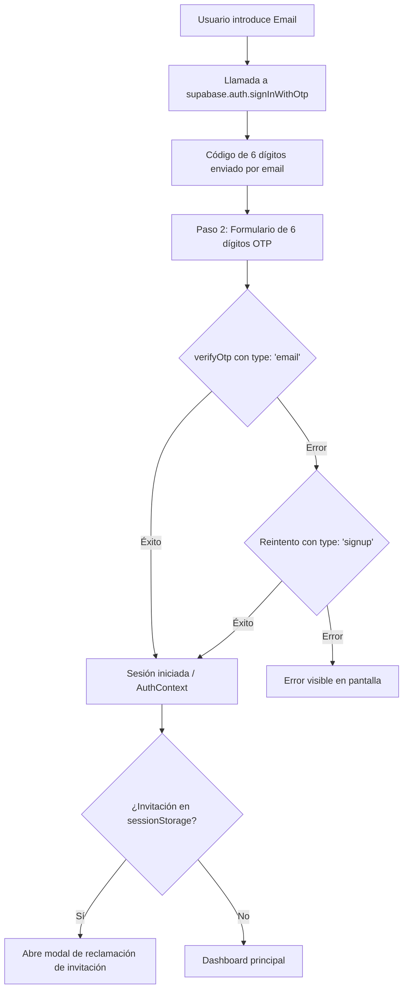

# 📱 Manual Funcional de Pantallas y Flujos de Usuario — MisDecimos

Este documento proporciona una guía detallada y exhaustiva sobre el funcionamiento, propósitos, controles interactivos y código fuente de cada pantalla, modal y flujo dentro de **MisDecimos**.

---

## 📑 Índice de Pantallas

1. [Acceso y Autenticación (Login)](#1-acceso-y-autenticación)
2. [Estructura Base y Navegación (AppShell)](#2-estructura-base-y-navegación)
3. [Dashboard Principal: Mis Billetes Compartidos](#3-dashboard-principal-mis-billetes-compartidos)
4. [Detalle del Décimo y Gestión de Cuotas](#4-detalle-del-décimo-y-gestión-de-cuotas)
5. [Bandeja de Alertas y Notificaciones](#5-bandeja-de-alertas-y-notificaciones)
6. [Centro Global de Auditoría y Trazabilidad](#6-centro-global-de-auditoría-y-trazabilidad)
7. [Mi Perfil, PWA y Ajustes](#7-mi-perfil-pwa-y-ajustes)

---

## 1. Acceso y Autenticación

- **Componente Principal:** [`src/pages/LoginPage.tsx`](../src/pages/LoginPage.tsx)
- **Contexto de Estado:** [`src/context/AuthContext.tsx`](../src/context/AuthContext.tsx)
- **Librería de Backend:** Supabase Auth (`auth.signInWithOtp`, `auth.verifyOtp`)

### Funcionalidad y Controles:
1. **Introducción de Correo Electrónico:**
   - Valida el formato del email y ejecuta `signInWithOtp({ email, options: { shouldCreateUser: true } })`.
   - Si la URL de entrada contiene un parámetro de invitación `?invite=TOKEN` o `/invite/:token`, [`AuthContext.tsx`](../src/context/AuthContext.tsx) lo persiste en `sessionStorage` (`pending_invite_token`) para reanudar la reclamación inmediatamente tras autenticarse.
2. **Entrada de Código OTP de 6 Dígitos:**
   - 6 inputs numéricos independientes con avance y retroceso automático de cursor (`focus`), soporte completo para pegar (*paste*) un código de 6 dígitos copiado del portapapeles.
   - **Mecanismo de Doble Verificación Anti-Fallo:** Se invoca `supabase.auth.verifyOtp` con `type: 'email'`. Si Supabase rechaza la petición porque el usuario es un registro nuevo no confirmado, se reintenta automáticamente con `type: 'signup'`.
3. **Temporizador de Reenvío:**
   - Cuenta atrás regresiva de 60 segundos antes de permitir reenviar el código.
   - Botón *"Cambiar correo"* para retroceder de paso en caso de errata.
4. **Pie de Página Dinámico:**
   - Muestra la versión real en ejecución `MisDecimos v${__APP_VERSION__}` enlazada a la constante de compilación.

---

## 2. Estructura Base y Navegación

- **Componente Contenedor:** [`src/components/layout/AppShell.tsx`](../src/components/layout/AppShell.tsx)
- **Badge Anti-Caché:** [`src/components/common/VersionBadge.tsx`](../src/components/common/VersionBadge.tsx)

### Elementos de la Interfaz:
1. **Cabecera Superior Fija con Safe-Area Dinámica y Navegación Adaptativa:**
   - **Diseño Visual "Titanio, Oro Cava y Verde Granito" (Claro / Oscuro OLED):** La interfaz aplica superficies `#F5F5F7` / `#FFFFFF` en modo claro y `#000000` / `#1D1D1F` en modo oscuro OLED, con botones primarios y cotitulares en Oro Cava (`#C5A880`), estados validados/propietario en Verde Granito (`#3A5245` / `#4E6E5D`), acciones destructivas/renuncias en Rojo Coral (`#D04848`) y selector rápido de apariencia (`Claro` / `Oscuro` / `Sistema`) en **Mi Perfil**.
   - **Campana de Alertas Estilo Apple:** El icono `Bell` en la barra superior y `BottomNav` se muestra en trazo fino (`1.75px`) sin relleno fuera de `/alertas` y relleno cuando está activa, sustituyendo el contador numérico por un punto de `7px × 7px` con efecto *cutout* y prioridad cromática (`#D04848` crítica, `#3A5245` premio, `#C5A880` general).
   - **Gestos Swipe en Listado Principal (`TicketsPage.tsx`):** Tanto las tarjetas de `DÉCIMO` como las de `PARTICIPACIÓN` muestran filos laterales (`#3A5245` izquierdo para **Archivar** al deslizar a la derecha; `#D04848` derecho para **Eliminar** en décimos propios o **Renunciar** en participaciones al deslizar a la izquierda).
   - **Padding y Área Segura:** Padding superior dinámico `pt-[calc(0.875rem+env(safe-area-inset-top))] pb-3.5 px-4 sm:px-6` que garantiza 14 px de aire vertical en escritorio y dispositivos sin notch, y absorbe fluidamente la zona del notch/isla dinámica en iOS y Android sin encajonar el contenido.
   - **Diseño Adaptativo Móvil vs Escritorio:**
     - **Izquierda Unificada (Marca e Inicio `/`):** En todos los dispositivos (móvil y escritorio), la cabecera muestra a la izquierda el logotipo oficial **4 MILLS** (`/logo-4mills.png`, bola de madera de bombo dentro de un squircle oscuro `w-9 h-9 rounded-xl object-contain shadow-sm`) acompañado del nombre de la marca en negrita (`MisDecimos`), funcionando como enlace interactivo directo a la pantalla principal (`/`) o ejecutando scroll suave hacia arriba si ya se está en ella.
     - **Dispositivos Móviles (`< 768px`):** En la esquina superior derecha muestra el botón compacto de usuario (avatar circular de 32 px + nombre recortado hasta 110 px sin email para evitar solapamientos en pantallas estrechas), con indicador de estado activo al encontrarse en **Perfil** o **Auditoría**, manteniendo las tres secciones principales (**Décimos**, **Premios** y **Alertas**) en la barra inferior para máxima ergonomía táctil.
     - **Navegadores de Escritorio (`>= 768px`):** En la parte derecha integra el menú horizontal con accesos a **Décimos**, **Premios** y **Alertas** (con badge dinámico de notificaciones sin leer), un separador vertical sutil (`h-6 w-px bg-gray-200`) y el botón compacto de usuario (avatar circular de 32 px + nombre de usuario), con indicador activo verde (`bg-[#2E6146]/[0.08] ring-1 ring-[#2E6146]/30`) al navegar a **Perfil** o **Auditoría**.
   - **Centralización de Cierre de Sesión:** El botón de salida se mantiene centralizado en la pantalla de **Perfil** para evitar clics accidentales.
2. **Barra Inferior Móvil (`BottomNav`) de 3 Pestañas y Respuesta Responsive:**
   - En dispositivos móviles (`< 768px`), la navegación se realiza mediante la barra fija inferior (`md:hidden`) en rejilla simétrica `grid-cols-3` con altura táctil mínima `min-h-[44px]`: **Décimos** (`<DecimoIcon />`, ruta `/`), **Premios** (`Trophy`, ruta `/premios`) y **Alertas** (`Bell` con contador de no leídas, ruta `/alertas`).
   - En ordenadores y tabletas (`>= 768px`), la barra inferior se oculta automáticamente y el relleno inferior de la pantalla se reduce (`pb-24 md:pb-10`), posicionando los toasts flotantes de forma ergonómica (`bottom-20 md:bottom-6`).
   - **Historial Completo de Navegación:** El cambio de pestaña añade entradas al historial de navegación (sin `replace: true`), permitiendo que el botón o gesto "Atrás" de Android regrese naturalmente a la vista anterior.
3. **Gestión del Botón Atrás de Android y Protección contra Cierre PWA (`useAndroidBackNavigation` y `useModalBackHandler`):**
   - **Cierre Natural de Modales y Sheets:** Al abrir cualquier diálogo (`TicketFormModal`, `CreateParticipationSheet`, `BarcodeScannerModal`, `ShareInviteModal`, `InviteClaimModal` o el modal de `<VersionBadge />`), pulsar el botón Atrás cierra limpiamente el modal sin abandonar la pantalla actual ni cerrar la aplicación.
   - **Navegación Interior:** En pantallas secundarias (`/alertas`, `/auditoria`, `/perfil`, `/billetes/:id`), pulsar Atrás regresa a la pantalla previa. Si se accedió por enlace profundo o notificación sin historial (`idx === 0`), redirige a la raíz `/` en vez de cerrar la PWA.
   - **Guardia Centinela en Ruta Raíz y Confirmación Doble Tap:** En la vista principal (`/`), el primer toque de Atrás muestra un toast flotante (`z-50`, encima de `BottomNav`): *"Pulsa atrás de nuevo para cerrar la aplicación"*. Si se pulsa de nuevo en menos de 2,5 segundos, la aplicación se cierra; si no, el aviso desaparece y la protección se rearma automáticamente.
4. **Componente `<VersionBadge />` (exclusivo en `Mi Perfil`):**
   - Integrado de forma limpia al pie de [`ProfilePage.tsx`](../src/pages/ProfilePage.tsx) (`variant="inline"`), eliminando el widget flotante del layout global para no interferir con el botón flotante `Añadir` ni tapar contenido en otras pantallas. Muestra `vX.Y.Z · <git-hash>` y el indicador de red (*Online/Offline*).
   - Al pulsar, abre un modal de diagnóstico técnico con la fecha de build y el botón *"Forzar actualización y limpiar caché"*, que vacía `caches`, desregistra Service Workers y recarga en limpio.
   - **Ciclo de vida `autoUpdate` silencioso:** El Service Worker descarga y activa inmediatamente las nuevas versiones en segundo plano (`skipWaiting: true`, `clientsClaim: true`) y recarga la interfaz una sola vez de forma limpia sin requerir confirmación del usuario ni mostrar carteles flotantes molestos. Comprueba actualizaciones cada 60 segundos y cada vez que el usuario regresa a la pestaña (`visibilitychange`).
5. **Onboarding Inteligente de Notificaciones Push (`<PushPermissionModal />` y `usePushPermissionPrompt`):**
   - **Solicitud No Intrusiva:** Dispara un modal adaptado a móvil (`z-50` sobre `BottomNav` con soporte de botón Atrás nativo) tras 1,5 segundos en la primera visita del usuario (`dismissals === 0`) o de forma contextualizada si recibe notificaciones sin leer (`unreadCount > 0`) sin tener el servicio push activado.
   - **Límite de 3 Cancelaciones:** Controla los descartes en `localStorage` por `user.id` con guardias en `sessionStorage` para no repetir preguntas en la misma sesión. Al alcanzar 3 cancelaciones o si el permiso es denegado en el navegador, el sistema no vuelve a solicitarlo de forma automática.
   - **Aviso Informativo con Enlace a Perfil:** Al pulsar *"Ahora no"* o cerrar el modal, se despliega un toast durante 5 segundos informando: *"No recibirás notificaciones push en este dispositivo. Siempre puedes activarlas o desactivarlas en tu Perfil."*, con enlace directo para navegar a `/perfil`.
6. **Instalador y Banner PWA Multiplataforma (`<PwaInstallBanner />` y `usePwaInstallPrompt`):**
   - **Detección Avanzada de Instalación:** Integra comprobación síncrona de modo standalone y asíncrona mediante `navigator.getInstalledRelatedApps()`, apoyado en el Web App Manifest oficial con `"id": "/"` y `"related_applications"`.
   - **Anti-Redundancia en Navegadores Chromium:** En Chrome/Edge/Brave/Samsung Internet, donde el navegador suprime el evento `beforeinstallprompt` si la app ya está instalada, el sistema nunca muestra automáticamente la guía manual de los tres puntos. Solo se activa si `deferredPrompt` está disponible de forma nativa.
   - **Recuperación tras Desinstalación y Caducidad Temporal (7 días):** Cuando la aplicación se ejecuta en modo navegador (`!display-mode: standalone` y `!navigator.standalone`), limpia automáticamente cualquier marca previa de instalación (`misdecimos_pwa_installed`) en `localStorage`. El botón secundario *«Ahora no»* (o *«Entendido»* en guías manuales) registra una caducidad temporal de **7 días** (`PWA_DISMISS_TTL_MS`) en `misdecimos_pwa_prompt_dismissed` en lugar de un bloqueo permanente.

---

## 3. Dashboard Principal: Mis Décimos Compartidos

- **Página:** [`src/pages/TicketsPage.tsx`](../src/pages/TicketsPage.tsx)
- **Tarjeta de Listado:** [`src/components/tickets/TicketListItemCard.tsx`](../src/components/tickets/TicketListItemCard.tsx)
- **Modal de Registro:** [`src/components/tickets/TicketFormModal.tsx`](../src/components/tickets/TicketFormModal.tsx)
- **Escáner de Código de Barras / QR:** [`src/components/tickets/BarcodeScannerModal.tsx`](../src/components/tickets/BarcodeScannerModal.tsx)
- **Parser Oficial GS1-128:** [`src/lib/selaeBarcodeParser.ts`](../src/lib/selaeBarcodeParser.ts)
- **Modal de Reclamación:** [`src/components/tickets/InviteClaimModal.tsx`](../src/components/tickets/InviteClaimModal.tsx)

### Pestañas del Dashboard (`TicketsPage.tsx`) y Pantalla `Premios` (`PrizesPage.tsx`):
- **Pantalla Principal (`/` — Décimos):** Listado único unificado sin pestañas ni filtros superiores de **Décimos** propios activos y **Participaciones** activas ordenados por fecha de sorteo (excluyendo los archivados), con badges identificativos (`Décimo` en verde / `Participación` en naranja), botón flotante **`Añadir`** encima de `BottomNav` y margen inferior `pb-32`. Al archivar un décimo vía swipe, muestra el toast *"Décimo archivado en tu cuenta. Puedes consultarlo en Mi Perfil."*. En la vista de detalle, **Propiedad y Reparto** incluye el botón **`Crear participación`** cuando el propietario tiene porcentaje libre y la cabecera muestra la etiqueta **`ARCHIVADO`** si corresponde.
- **Pantalla Premios (`/premios` — [`src/pages/PrizesPage.tsx`](../src/pages/PrizesPage.tsx)):**
  - **Bloque Superior — Tarjetas KPI:**
    - **Décimos Activos:** Suma los décimos propios no archivados más las participaciones no archivadas en estado `ACEPTADA` (excluyendo `RENUNCIADA`, `PENDIENTE`, `CANCELADA`, `RECHAZADA` y archivados).
    - **Total Premios:** Suma en euros (`€`) la cuota proporcional exacta del usuario (`porcentaje_usuario %` sobre `prize_amount_cents`) de todos sus décimos y participaciones activas premiadas.
  - **Bloque Inferior — Historial de Escrutinio (`Todos`, `Premiados`, `Sin premio`):**
    - Muestra primero los décimos premiados de mayor a menor importe (con categoría oficial y cuota del usuario) y a continuación los ya comprobados sin premio (`Comprobado · Sin premio`, `0,00 €`) ordenados del sorteo más reciente al más antiguo. Al pulsar cualquier fila navega a `/billetes/:id`.
- **Pestañas de Filtrado y Sincronización en URL (`?tab=...`):**
  - **Mis Décimos (`/` o `/?tab=decimos`):** Muestra los décimos donde el usuario actual es el custodio legal y propietario registrador (`owner_id = user.id`).
  - **Mis Participaciones (`/?tab=participaciones`):** Muestra los décimos donde el usuario ha sido invitado y posee una cuota activa aceptada (`status = 'ACEPTADA'` y `percentage > 0`). Las participaciones renunciadas no se muestran aquí.
  - **Archivados (`/?tab=archivados`):** Décimos propios o participaciones activas ocultados o archivados por el usuario para limpiar su vista principal. Las participaciones renunciadas quedan excluidas.
  - **Persistencia de Navegación Bidireccional:** La pestaña activa se sincroniza con `useSearchParams` (`{ replace: true }`) y con `state: { fromTab: activeTab }`. Al abrir la ficha de un décimo y regresar (mediante el botón superior Atrás o el botón físico de Android), la aplicación preserva de forma estricta la pestaña en la que se encontraba el usuario. En aperturas directas sin historial (push/deep-link), el botón superior deriva inteligentemente a `/?tab=participaciones` para cotitulares o a `/` para propietarios.
- **Diseño de Tarjetas en el Listado (`<TicketListItemCard />`):**
  - **Icono Oficial de Décimo (`<DecimoIcon />`):** Representación rectangular limpia sin muescas laterales de tómbola, con marco interior, sello circular y líneas de numeración (usado también en la navegación inferior y pestañas).
  - **Filos Laterales de Deslizamiento:** Borde izquierdo verde (`border-l-4 border-l-emerald-600`) y derecho rojo (`border-r-4 border-r-rose-500`) en cada tarjeta (`rounded-2xl overflow-hidden`) indicando visualmente los gestos de **Archivar** y **Eliminar**.
  - **Tarjetas Pendientes o No Premiadas:** Contenedor blanco minimalista (`bg-white rounded-2xl`), icono de décimo o archivo en esquina superior izquierda, recuadro de número central en gris claro (`bg-gray-50/90`) y pie de tarjeta con botones de acción rápida aislados.
  - **Tarjetas Premiadas Destacadas (`prize_amount_cents > 0`):**
    - **Acabado Celebratorio Dorado/Esmeralda:** Fondo con degradado sutil (`bg-gradient-to-br from-amber-50/90 via-white to-emerald-50/75`), borde doble destacado (`border-2 border-amber-400/85`), halo suave (`ring-2 ring-amber-300/25 shadow-md shadow-amber-900/5`) y franja superior de acento degradado (`from-amber-400 via-yellow-400 to-emerald-500`).
    - **Icono y Badge Ganador:** Icono superior izquierdo de trofeo dorado (`bg-amber-100 text-amber-700 border border-amber-300/80`) y badge dinámico **`¡PREMIADO!`** (o **`LIQUIDADO`**) en degradado dorado/ámbar con icono `Sparkles`.
    - **Banner de Premio Integrado:** Recuadro destacado verde esmeralda (`bg-emerald-600/10 border border-emerald-500/25 rounded-2xl`) con icono `Trophy` que resalta con gran jerarquía el importe personal del usuario (ej. **`750,00 € tuyos`**) y el premio total del décimo (`Décimo: 1.000,00 €`). En caso de participación renunciada previa, muestra de forma transparente `Cuota: Renunciada (0,00 €)`.
    - **Consistencia Total:** Se aplica con idéntico diseño en las pestañas **Décimos**, **Participaciones** y **Archivados**.

### Acciones en Tarjetas y Botón Principal:
- **Gestos Swipe en Tarjetas (`<SwipeableTicketCard />`):**
  - **Deslizar hacia la derecha:** Revela en el fondo izquierdo el botón **Archivar** / **Restaurar** (la acción se ejecuta únicamente al pulsar el botón).
  - **Deslizar hacia la izquierda:** Revela en el fondo derecho el botón **Eliminar** (solicita confirmación antes de borrar).
  - Solo una tarjeta permanece abierta a la vez; pulsar una tarjeta abierta cierra el desplazamiento sin navegar.
- **Acciones Rápidas en Cada Tarjeta (`<TicketListItemCard />`):**
  - **Botón `Compartir`:** Situado a la derecha de la fecha del sorteo (con `e.stopPropagation()`). Si el décimo no tiene participaciones ni invitaciones pendientes, navega al detalle abriendo automáticamente el modal de nueva participación (`openCreateShare: true`); si ya tiene participaciones, navega con `selectShareToShare: true` y dispara un toast flotante dentro del detalle (*"Selecciona una participación para compartir"* · *"Pulsa sobre cualquiera de las participaciones de la lista para ver su enlace o código."*).
  - **Botón `Comprobar sorteo`:** Situado en la esquina inferior izquierda (con `e.stopPropagation()`). Si la fecha del sorteo es futura (`draw_date > hoy`), muestra un aviso claro sin invocar red; si ya se celebró (`draw_date <= hoy`), ejecuta la Edge Function `check-prizes`, actualiza el estado del décimo y notifica el resultado en un toast.
1. **Botón Único de Ancho Completo `Añadir` (Escáner Unificado):**
   - Botón verde corporativo a ancho completo (`w-full bg-emerald-700 hover:bg-emerald-800 text-white`) que abre instantáneamente la cámara trasera mediante [`BarcodeScannerModal.tsx`](../src/components/tickets/BarcodeScannerModal.tsx).
   - Dentro del visor de cámara unificado (también invocado desde *"Escanear Código"* en el formulario manual), se muestran los botones inferiores **"Tengo un código"** (abre el modal de reclamación por PIN/QR) y **"Añadir décimo manual"** (abre [`TicketFormModal.tsx`](../src/components/tickets/TicketFormModal.tsx)).
     - **Enrutamiento y Autocompletado Inteligente:** Si el usuario enfoca un décimo físico de SELAE, el parser descompone la estructura canónica `1 + 3 + 1 + 2 + 3 + 6 + 4` (juego `5`, sorteo `102` Navidad / `002` El Niño, año `2020 + d`, fracción, serie, número de 5 cifras y control), autoselecciona de inmediato el **Tipo de Sorteo** (**Navidad** o **El Niño**), la **Fecha del Sorteo** (`YYYY-12-22` o `YYYY-01-06`), número, serie, fracción y precio oficial (20 €), abriendo [`TicketFormModal.tsx`](../src/components/tickets/TicketFormModal.tsx) en la pestaña `'manual'` con el banner verde esmeralda: *"Código leído correctamente — Verifica los datos antes de guardar"*. Si por el contrario el usuario enfoca un código QR de invitación o participación, el escáner lo detecta de forma inteligente y abre directamente [`InviteClaimModal.tsx`](../src/components/tickets/InviteClaimModal.tsx) con el código precargado y verificado.
     - **Tolerancia y Aviso Inline:** Si se lee un código desconocido, se muestra un aviso visual en la parte superior del visor sin interrumpir la cámara ni cerrar el modal, permitiendo corregir el encuadre.
     - **Recuperación Automática de Segundo Plano (`visibilitychange`):** Al cambiar de aplicación o apagar la pantalla, la cámara libera limpiamente sus pistas para evitar el bloqueo del hardware en Android. Al regresar a la PWA, tras 350 ms de estabilización, el escáner se reactiva automáticamente. Cuenta con hasta 2 reintentos silenciosos ante errores transitorios y oculta el fotograma congelado en caso de requerir intervención del usuario.
   - Al guardar, ejecuta la RPC transaccional `create_ticket`, asegurando el 100% de titularidad inicial y navegando inmediatamente a la ficha de detalle.
2. **Botón "Reclamar / Canjear Código" (o QR):**
   - Abre [`InviteClaimModal.tsx`](../src/components/tickets/InviteClaimModal.tsx) o [`InvitePage.tsx`](../src/pages/InvitePage.tsx) si se accede por enlace web `/invite/:id`.
   - Permite introducir el código de 6 dígitos o escanear el código QR recibido por WhatsApp/email.
   - Realiza una previsualización de la participación (número, sorteo, porcentaje e importe en €) mediante `previewInvite` (`src/services/inviteService.ts`) y ofrece dos opciones:
     - **"Aceptar y Asignar a mi cuenta":** Ejecuta `claimInvite` (`accept_pending_invite` RPC), garantizando el retorno del `ticket_id` y transfiriendo formalmente la cuota.
     - **"Rechazar Participación":** Ejecuta `rejectInvite` (`reject_pending_invite` RPC), reintegrando de inmediato el porcentaje al propietario.
   - **Apertura Directa del Décimo y Retorno Garantizado a `Participaciones`:**
     - Al pulsar *"Aceptar y ver mi participación"*, los botones se deshabilitan inmediatamente para evitar dobles pulsaciones y el botón muestra *"Aceptando participación..."*.
     - Al confirmar con éxito:
       1. Cierra de forma inmediata el modal (`onClose()`).
       2. Sustituye la entrada actual en el historial del navegador (`/invite/:id` o `/`) por `/?tab=participaciones` (`replace: true`).
       3. Navega inmediatamente a la ficha del décimo reclamado (`/billetes/:id`) transmitiendo `state: { fromTab: 'participaciones', claimMessage: '¡Participación del X% reclamada correctamente!' }`.
       4. En el detalle del décimo, se muestra un banner superior esmeralda con el mensaje de confirmación, y si el usuario retrocede (con el botón Volver o el botón Atrás de Android), aterriza directamente en la pestaña **Participaciones** (`/?tab=participaciones`), donde el billete reclamado figura de inmediato en su lista activa.

---

## 4. Detalle del Décimo y Gestión de Cuotas

- **Página Principal:** [`src/pages/TicketDetailPage.tsx`](../src/pages/TicketDetailPage.tsx)
- **Cuadro de Propiedad:** [`src/components/tickets/OwnershipBreakdownCard.tsx`](../src/components/tickets/OwnershipBreakdownCard.tsx)
- **Línea Temporal de Auditoría:** [`src/components/tickets/TicketAuditTimeline.tsx`](../src/components/tickets/TicketAuditTimeline.tsx)
- **Boleto Realista:** [`src/components/tickets/RealisticTicketCard.tsx`](../src/components/tickets/RealisticTicketCard.tsx)
- **Comprobación de Premios:** [`src/components/tickets/PrizeCheckCard.tsx`](../src/components/tickets/PrizeCheckCard.tsx)
- **Reparto y Participaciones:** [`src/components/tickets/CreateParticipationSheet.tsx`](../src/components/tickets/CreateParticipationSheet.tsx)
- **Modal de Compartición (QR / Link / WhatsApp):** [`src/components/tickets/ShareInviteModal.tsx`](../src/components/tickets/ShareInviteModal.tsx)

### Estructura Vertical y Jerarquía de Contenidos:
1. **Cabecera Superior Fija:** Botón ergonómico de retroceso contextual (`<-`, área táctil accesible `>= 44×44 px` con `aria-label="Volver atrás"`), título *"Detalles del Décimo"*, subtítulo con número y sorteo (`#número · Sorteo...`) e insignia de estado (`VALIDADO` / `PENDIENTE` / `¡PREMIADO!`).
2. **Bloque Principal de Reparto e Historial (Cabecera de Contenido):**
   - Selector de pestañas simétrico (`grid-cols-2`, altura táctil `>= 44 px`) con espaciado vertical compacto en móvil para mantener el décimo visible en el primer pliegue: **Propiedad y Reparto** (`Users`) e **Historial** (`Shield`).
   - Vista **Propiedad y Reparto**: Gráfico Donut SVG de precisión, desglose de cotitulares con importes y estados, y botón de acción *"Añadir participación"*.
   - Vista **Historial**: Línea cronológica inmutable de eventos de auditoría (`TicketAuditTimeline`).
3. **Boleto Realista y Metadatos Técnicos:**
   - Tarjeta visual completa del décimo (`RealisticTicketCard`) con sello digital interactivo (5 pulsaciones para panel de diagnóstico en custodios).
   - Fila de metadatos inferiores (`FECHA SORTEO` y `ORIGEN: Escáner GS1-128 / Manual`).
4. **Tarjeta de Premio Oficial (condicional):** Si el décimo tiene premio (`prize_amount_cents > 0`), muestra la tarjeta esmeralda de resultado, desglose proporcional y confirmación de cobro (sin botón de comprobación manual, ya unificado en el listado).
5. **Panel Diagnóstico de Simulación:** Panel desplegable púrpura (oculto, accesible con 5 toques sobre el sello digital del décimo) para simular premios y restablecer estados de prueba.
6. **Salvaguarda de Cotitulares:** Aviso de protección cuando existen participaciones aceptadas.

### Módulos Integrados en el Detalle:

#### A) Tarjeta de Décimo Realista (`<RealisticTicketCard />`)
- Representación visual del décimo con diseño fiel al papel oficial de SELAE, textura guilloché de seguridad, código de barras simulado, fecha del sorteo, precio e insignia de custodia legal asignada al propietario.
- **Mecanismo de Fallback Anti-Imagen Rota:** Integra un listener reactivo `onError` que, ante cualquier fallo de carga o ausencia de imagen de plantilla externa (`template_image_url`), conmuta de forma automática e inmediata al motor vectorial completo (filigrana guilloché, capilla artística con sello digital `MisDecimos`, número matricial y código GS1-128), evitando iconos de imagen rota en el navegador.

#### B) Comprobador Oficial de Premios (`<PrizeCheckCard />`)
- **Bloqueo Previo al Sorteo y Tarjeta Informativa:** Si la fecha y hora oficial de inicio del sorteo aún no ha llegado en horario peninsular español (`Europe/Madrid` CET: 22 de diciembre a las 09:00 para Navidad, 6 de enero a las 12:00 para El Niño):
  - El botón principal aparece deshabilitado mostrando el icono `CalendarClock` y el texto *"Disponible el DD/MM/YYYY"*, previniendo peticiones prematuras a la Edge Function.
  - Se sustituye el recuadro de resultados por una tarjeta informativa ámbar con icono `CalendarClock`: *"El sorteo aún no se ha realizado. Se celebrará el [fecha] (faltan X días). Podrás comprobar si tiene premio a partir de ese día."*
- **Consulta Oficial, Motor Histórico (2020–2025) y Validación Estricta por Año:**
  - El botón *"Comprobar premio"* (o *"Comprobar de nuevo"*) invoca la Supabase Edge Function `check-prizes` transmitiendo `ticketId`, `number`, `drawType` y la fecha canónica `drawDate`.
  - **Diferenciación Visual de Estados:**
    - **Sorteo Futuro / En Curso:** Aviso informativo en tono ámbar suave indicando la fecha futura de celebración o que el sorteo del día de hoy se encuentra en escrutinio.
    - **Histórico No Disponible:** Ante décimos de sorteos históricos no cubiertos por la base oficial (fuera de 2020–2025), muestra un banner de aviso en paleta ámbar/naranja (`bg-amber-50/90 border-amber-300/80` con icono `CalendarOff` en `text-amber-600`) indicando *"Histórico no disponible: No hay resultados históricos disponibles en el proveedor oficial para el sorteo del DD/MM/AAAA"*, manteniendo la coherencia cromática de los avisos informativos y permitiendo archivar y gestionar el décimo con total normalidad.
    - **Comprobado Sin Premio (`0 €`):** Tarjeta clara *"Comprobado · Sin premio en el sorteo oficial del DD/MM/AAAA"* indicando como fuente *"Archivo Oficial Histórico"* (o el proveedor oficial correspondiente), garantizando confirmación inequívoca sin banners de error.
    - **Comprobado Con Premio (`> 0 €`):** Tarjeta destacada en verde esmeralda con el trofeo oficial, la categoría oficial del premio (ej. *"Resultado Oficial · El Gordo (1.º premio)"*, *"Resultado Oficial · Reintegro"*), el importe total del décimo y el desglose exacto de la cuota y premio personal del usuario.
- **Desglose Fiscal (Ley 16/2012):** Calcula automáticamente el premio total, la exención de los primeros 40.000 € y la retención del 20% de IRPF para obtener el importe neto a liquidar.
- **Cuota Individual:** Muestra a cada participante el importe exacto bruto y neto que le corresponde en base a su porcentaje aceptado.
- **Confirmación de Cobro:** Botón *"He recibido mi premio"*, disponible para cotitulares cuando el estado es `VALIDADO`. Ejecuta `confirm_prize_paid` registrando fecha, hora e IP para la liquidación formal unánime.

#### B.1) Panel Diagnóstico: Modo Prueba de Premio (Simulación de Custodio)
- **Activación Segura:** Visible exclusivamente para el custodio propietario (`isOwner === true`) en entornos de desarrollo (`import.meta.env.DEV`) o al tocar 5 veces consecutivas sobre el `"MISDECIMOS SELLO DIGITAL"` en el décimo realista.
- **Botón "Simular premio (1.000 €)":** Invoca la Edge Function `check-prizes` con `simulatedPrizePerDecimo: 1000`. Ejecuta la tubería oficial transaccional de escrutinio (`record_ticket_prize_check`), distribuyendo el premio en céntimos y euros entre todas las cuotas en estado `ACEPTADA`, registrando el evento de auditoría `PREMIO_REGISTRADO` con `shares_breakdown` y despachando alertas Web Push nativas a los cotitulares.
- **Botón "Restablecer décimo":** Invoca la Edge Function `check-prizes` con `resetSimulation: true` ejecutando `reset_ticket_prize_simulation`, que restablece atómicamente el décimo a 0,00 € y estado `PENDIENTE`, resetea confirmaciones de cobro y añade el evento de auditoría `SIMULACION_PREMIO_RESTABLECIDA`.

#### C) Cuadro de Propiedad y Gráfico Donut SVG (`<OwnershipBreakdownCard />`)
- **Gráfico Donut SVG Sólido de Alta Precisión:** Anillo continuo mediante `<circle>` SVG (`viewBox="0 0 160 160"`, centro `(80, 80)`, radio `r = 62`, grosor `15` y `strokeLinecap="butt"` rotado `-90°`), con círculo base completo en gris `#E5E7EB` y arcos sólidos continuos por cada categoría `> 0` con desplazamiento acumulado (`strokeDashoffset`) sin solapamientos: verde `#2E6146` para Propietario, azul `#2563EB` para Cotitulares y naranja `#D97706` para Pendientes/Sin asignar, con transiciones fluidas animadas (`transition-all duration-500 ease-out`). En el centro certifica el porcentaje total distribuido (Principio Cero Huérfanos).
- **Lista de Cotitulares:** Nombre, avatar, porcentaje exacto, importe jugado y estado de cuota (`ACEPTADA`). Al registrarse un premio (`prize_amount_cents > 0`), muestra para el propietario y cada cotitular su importe proporcional en euros con estado de cobro (`COBRADO`, `CUSTODIO` o `PENDIENTE DE COBRO`).
  - **Menú Contextual Flotante (`...`):**
    - **En estado `PENDIENTE`:** El propietario dispone del botón de opciones (`MoreVertical`) con menú contextual desbloqueado (`z-30`/`z-40` libre de recortes por `overflow`) y auto-cierre al pulsar fuera (`mousedown`/`touchstart`) para iniciar el flujo de solicitud de renuncia de participación.
    - **En décimos premiados (`prize_amount_cents > 0`):** Para cada cotitular que figure como `PENDIENTE DE COBRO`, el propietario cuenta con el menú de tres puntos con la acción **"Solicitar confirmación de cobro"** (o *"Reenviar solicitud de cobro"* si ya se emitió). Al accionarlo, invoca `request_prize_payout_confirmation`, despacha una notificación Push al participante y muestra el banner en ámbar: *"Solicitud de confirmación de cobro enviada. Esperando respuesta del participante."*
  - **Confirmación Directa del Cotitular:** Cuando un cotitular autenticado consulta un décimo premiado con cobro pendiente, visualiza de forma destacada dentro de su tarjeta el botón verde **"Confirmar cobro recibido (X,XX €)"**. Al pulsarlo, ejecuta `confirm_prize_payout_received`, actualizando la cuota a `COBRO CONFIRMADO`, notificando al custodio y liquidando automáticamente el billete si todos han confirmado.
- **Participaciones Renunciadas:** Si un participante renunció a su cuota, se lista de forma transparente al final con opacidad reducida, indicando `0%`, `0,00 €` y la nota *"Renuncia formal registrada en auditoría"*, certificando la trazabilidad jurídica completa.
- **Invitaciones Pendientes (Privacidad Exclusiva del Propietario):**
  - **Renderizado Condicional Estricto (`isOwner === true`):** El listado de tarjetas amarillas de invitaciones pendientes, los códigos PIN de 6 dígitos, los botones *"Ver QR / Compartir"*, *"Eliminar"* y *"Cancelar todas las pendientes"* solo se muestran si el usuario es el propietario del décimo.
  - **Vista Neutra para Participantes (`!isOwner`):** En el gráfico Donut y su leyenda, cualquier cuota pendiente o aún no aceptada se visualiza como un porcentaje agregado neutro (*"Sin asignar / Pendiente (X%)"*) sin mostrar nombres, códigos PIN ni enlaces de invitaciones.
- **Añadir Participación y Eliminación de Décimo:** El botón inferior *"Añadir participación"* permanece disponible tanto en `PENDIENTE` como en `VALIDADO` mientras el propietario conserve cuota libre. Asimismo, el botón *"Eliminar décimo"* está habilitado en ambos estados siempre que no existan cuotas de terceros en estado `ACEPTADA`.
- **Flujo Bilateral de Renuncia de Participaciones (Gesto Swipe Izquierdo):**
  - El custodio puede deslizar hacia la izquierda la tarjeta de cualquier participante aceptado en estado `PENDIENTE` (identificada con un filo derecho de `3px` en Rojo Coral `#D04848`) para revelar **`Solicitar renuncia`**.
  - El participante recibe una alerta y puede *"Aceptar y devolver"* (reintegrando el porcentaje al propietario) o *"Rechazar"*.
- **Renuncia Voluntaria Directa del Participante (Gesto Swipe Izquierdo):**
  - En la tarjeta de participación del propio usuario autenticado (`share.user_id === user.id`), mientras el décimo no esté liquidado ni premiado pendiente de cobro, el filo derecho de `3px` en Rojo Coral (`#D04848`) indica que puede deslizarse hacia la izquierda para revelar **`Renunciar`**.
  - Al pulsarla, abre un diálogo de confirmación (`z-50` sobre `BottomNav` con integración `useModalBackHandler`) indicando el porcentaje y su importe exacto en euros. Al confirmar, ejecuta la función transaccional `renounce_own_participation`, reintegrando el porcentaje íntegro al propietario, registrando la auditoría y notificando al custodio.
- **Redirección Inmediata y Blindaje de Historial tras Renunciar:**
  - Tanto al renunciar voluntariamente como al aceptar una solicitud de renuncia del custodio, la aplicación no permanece en la ficha del décimo:
    - Redirige inmediatamente a la pestaña **Participaciones** (`/?tab=participaciones`) sustituyendo la entrada actual del historial (`replace: true`).
    - Muestra un toast informativo en color esmeralda: *"Has renunciado a la participación. El décimo se ha retirado de tus participaciones."*.
    - Al usar el botón Atrás de Android o del navegador, no se reabre el billete renunciado.
- **Protección de Entrada Directa a Décimos Renunciados:**
  - Si un usuario intenta acceder a `/billetes/:id` (por ejemplo, desde una notificación previa o historial antiguo) para un décimo donde ya no es propietario ni tiene participación activa (por haber renunciado), `TicketDetailPage` intercepta la carga, muestra el toast *"Ya no tienes acceso a este décimo porque renunciaste a tu participación."* y redirige de inmediato a `/?tab=participaciones` (`replace: true`).

#### D) Reparto de Participaciones (`<CreateParticipationSheet />`)
- **Arquitectura Móvil Flex con Scroll Interno y Pie Fijo:**
  - Contenedor con altura dinámica `max-h-[88dvh]` y capa `z-50` que cubre por completo tanto la cabecera como la barra de navegación inferior (`BottomNav`).
  - **Cabecera fija (`shrink-0`):** Muestra el título *"Nueva Participación"*, el porcentaje disponible en tiempo real y el botón de cierre (`X`).
  - **Cuerpo con scroll (`flex-1 overflow-y-auto overscroll-contain`):** Contiene el selector de modo, stepper de partes o slider de porcentaje, e información matemática sin desbordar la pantalla en navegadores móviles (Chrome/Safari).
  - **Pie fijo de acción (`shrink-0` con `env(safe-area-inset-bottom)`):** Botón verde de confirmación siempre accesible y anclado en la parte inferior sobre la zona segura de dispositivos iOS y Android.
- Permite crear nuevas participaciones antes del sorteo con selector de pestañas reordenado:
  - **Pestaña por defecto:** Abre automáticamente en **"Partes iguales"** (primera pestaña, izquierda) cuando el custodio conserva el 100% de la cuota y no existen participaciones previas; si ya existen participaciones parciales, selecciona automáticamente **"Porcentaje manual"** (segunda pestaña, derecha) con un valor predeterminado del 20% (o el máximo disponible).
  - **Reparto a Partes Iguales:** Entre N personas (ej. 2, 3, 4, 5 cotitulares), aplicando el algoritmo de absorción de redondeo en el custodio para garantizar suma exacta del 100,00%. Genera una bolsa de invitaciones pendientes con un código único de 6 dígitos y enlace para cada cotitular.
  - **Reparto Manual:** Especificando porcentaje (%) o importe en euros (€), con preconfiguración al 20%.
- Al guardar, abre [`ShareInviteModal.tsx`](../src/components/tickets/ShareInviteModal.tsx), que genera:
  - Enlace web directo `https://misdecimos.dianrie.com/invite/<token>`
  - Código numérico de 6 dígitos (`short_code`)
  - Código QR dinámico generado con `qrcode.react`
  - Botón directo para compartir el mensaje oficial por **WhatsApp** y Web Share API:
    - Centralizado en `src/lib/shareHelper.ts` (`buildWhatsAppShareMessage` y `buildWhatsAppShareUrl`) con secuencias Unicode seguras (`\u{1F3AB}`, `\u{1F511}`, `\u{1F449}`) para evitar caracteres corruptos (`\uFFFD`) en vistas previas y codificación URI.
    - Mecanismo de respaldo (fallback) para WhatsApp Escritorio (macOS/Windows): al pulsar "Enviar por WhatsApp", el mensaje completo se copia automáticamente al portapapeles y se muestra un banner contextual indicando que el usuario puede usar *Pegar (Cmd+V / Ctrl+V)* en caso de que el cliente de escritorio descarte el cuerpo y solo pegue la URL.

#### E) Auditoría del Décimo (`<TicketAuditTimeline />`)
- Historial inmutable y cronológico de todas las mutaciones producidas sobre el décimo: creación, escaneos, cesión de porcentajes, invitaciones reclamadas, renuncias solicitadas/aceptadas y confirmaciones de cobro de premios.

---

## 5. Bandeja de Alertas y Notificaciones

- **Página:** [`src/pages/AlertsPage.tsx`](../src/pages/AlertsPage.tsx)
- **Backend:** Tabla `public.notifications` con suscripción Supabase Realtime y Web Push.

### Funcionalidad y Controles:
1. **Filtro de Estado:** Alternador entre *"Todas las alertas"* y *"Solo no leídas"*.
2. **Formato Temporal:** Estampas temporales formateadas en `HH:mm - DD/MM` (ej. `14:35 - 22/12`).
3. **Acciones Rápidas y Protección de Acceso en la Alerta:**
   - Si la alerta corresponde a una solicitud de renuncia de participación activa, ofrece directamente dos botones:
     - ✅ **Aceptar Renuncia:** Ejecuta `respond_share_waiver(..., p_accept = true)`.
     - ❌ **Rechazar:** Ejecuta `respond_share_waiver(..., p_accept = false)`.
   - **Bloqueo de Décimos Renunciados:** Si el usuario ya ha renunciado a su participación en el billete al que apunta la alerta (`status === 'RENUNCIADA'`):
     - La tarjeta de alerta y los botones de acción inhabilitan la navegación hacia `/billete/:id`.
     - El enlace *"Ver billete"* se sustituye por la insignia deshabilitada `Participación renunciada · Sin acceso`.
     - Al pulsar la alerta, esta se marca como leída y muestra un toast informativo (`Ya renunciaste a esta participación; no tienes acceso al décimo.`) sin permitir el acceso al billete.
   - Para alertas con participación activa o de propietario, clicar en la alerta o en *"Ver billete"* redirige al detalle del décimo correspondiente.
4. **Deep-Linking Directo desde Notificaciones Web Push (Android PWA):**
   - Al pulsar una notificación Web Push en Android, la aplicación se abre y navega directamente al detalle del billete (`/billetes/:id`) tanto en arranque en frío como con la app en segundo plano.
   - La notificación pulsada se marca automáticamente como leída en segundo plano en Supabase (`is_read = true`).
5. **Botón "Leídas todas":** Invoca la RPC `mark_all_notifications_read`, actualizando el estado de lectura y poniendo a 0 el badge de la campana.

---

## 6. Centro Global de Auditoría y Trazabilidad

- **Página:** [`src/pages/AuditPage.tsx`](../src/pages/AuditPage.tsx)
- **Acceso:** Desde la tarjeta dedicada en **Perfil** (`/perfil`), o ruta directa `/auditoria`. Cuenta con botón superior *"Volver a Perfil"*.
- **Backend:** Tabla inmutable `public.audit_events` (sin permisos de UPDATE o DELETE en RLS).

### Secciones Principales:
1. **Acordeón de las 4 Reglas de Oro:**
   - 🔒 **Custodia Inmutable:** El custodio registrador inicial nunca puede transferirse a un tercero.
   - ⚖️ **Cero Huérfanos:** La suma de porcentajes de un décimo debe ser siempre exactamente 100,00%.
   - 🛡️ **Trazabilidad Inmutable:** Cada cesión, renuncia y liquidación se registra con estampa de tiempo y usuario.
   - 🤝 **Liquidación Unánime:** La marcación como `LIQUIDADO` exige que todos los participantes confirmen el cobro.
2. **Buscador y Filtros por Categoría:**
   - Barra de búsqueda libre (número de décimo, tipo de evento o nombre del participante).
   - Chips de filtrado rápido: *Todos, Creación, Participaciones, Premios, Seguridad*.
3. **Línea Temporal Global:**
   - Explorador de eventos de toda la plataforma a los que el usuario tiene acceso legítimo, con tarjeta desplegable de metadatos técnicos (dirección IP, navegador, método de origen y hashes).

---

## 7. Mi Perfil, PWA y Ajustes

- **Página:** [`src/pages/ProfilePage.tsx`](../src/pages/ProfilePage.tsx)
- **Servicio Push:** [`src/services/push/pushSubscription.ts`](../src/services/push/pushSubscription.ts)
- **Banner PWA:** [`src/components/pwa/PwaInstallBanner.tsx`](../src/components/pwa/PwaInstallBanner.tsx)
- **Storage:** Bucket Supabase Storage `avatars` con RLS por UID.

### Opciones y Controles:
1. **Avatar de Usuario con Selector Dual (Cámara / Galería) y Compresión en Cliente:**
   - Al pulsar sobre el avatar circular o la insignia verde de cámara, se abre un menú inferior (*Action Sheet / Bottom Sheet*) integrado en `z-50` con soporte del botón Atrás de Android (`useModalBackHandler`):
     - **Hacer foto con la cámara:** Dispara el input nativo con `capture="user"` para abrir directamente la cámara del dispositivo móvil.
     - **Elegir de la galería o archivos:** Dispara el explorador de archivos o álbum de fotos del sistema sin forzar la cámara.
     - **Eliminar foto actual:** Disponible si ya existe un avatar registrado, restableciendo el avatar neutral por defecto.
   - Redimensiona automáticamente a 512x512 y convierte la imagen a formato **WebP** en el navegador para ahorrar ancho de banda y optimizar la carga.
   - Sube el archivo al bucket seguro `avatars` en Supabase Storage bajo la carpeta del usuario `auth.uid()`.
2. **Datos Personales Sanitizados:**
   - Campos de *Nombre a mostrar* y *Teléfono de contacto*, protegidos contra inyecciones XSS mediante `sanitizeText`.
3. **Gestión de Notificaciones Web Push (VAPID):**
   - Interruptor (*Toggle*) para activar/desactivar notificaciones nativas en el dispositivo. Al activarlo manualmente, se resetea automáticamente a 0 el contador de descartes del onboarding push.
   - Sincronización automática de suscripción en `public.web_push_subscriptions` y actualización reactiva de permisos.
   - Botón *"Enviar notificación de prueba"*: Verifica primero la concesión real de permisos en el sistema operativo (`Notification.permission === 'granted'`), resincroniza silenciosamente la suscripción actual antes del envío (`syncPushSubscription`), invoca la Edge Function `send-push` en modo test y muestra feedback preciso y transparente: confirma el número de dispositivos alcanzados (`sent > 0`) o reporta el error técnico exacto sin emitir falsos positivos.
4. **Instalación de la PWA Multiplataforma (`PwaInstallBanner.tsx`, `usePwaInstall.ts` y `usePwaInstallPrompt.ts`):**
   - **Captura Global en Arranque (`src/main.tsx`):** Escucha `beforeinstallprompt` desde el montaje inicial y persiste el evento en `window.__deferredPwaPrompt`, evitando que la oportunidad de instalación nativa se pierda si el usuario navega entre pantallas antes de abrir el Perfil.
   - **Detección Fidedigna de Modo Standalone:** Comprueba activamente el modo de visualización real (`display-mode: standalone`, `navigator.standalone` y `android-app://`), previniendo que flags caducados de instalaciones anteriores en `localStorage` oculten erróneamente el instalador tras una desinstalación en Chrome Android.
   - **Comportamiento en la Pantalla de Perfil (`ProfilePage.tsx`):**
     - **Si `isStandalone === true`:** Muestra un indicador discreto *"Aplicación instalada en este dispositivo"* con check verde.
     - **Si `isStandalone === false`:** Muestra siempre el botón interactivo *"Instalar aplicación en tu dispositivo"* (tanto en móviles como en PC):
       - Si `deferredPrompt` nativo está disponible: Lanza el diálogo nativo del sistema operativo en un solo toque mediante `prompt()`.
       - Si `deferredPrompt` es `null` (periodo de enfriamiento de Chrome Android tras desinstalar o navegador iOS Safari): Abre un modal guiado con instrucciones directas adaptadas al dispositivo:
         - **Android (Chrome):** *"1. Pulsa el menú ⋮ arriba a la derecha en Chrome · 2. Selecciona «Añadir a pantalla de inicio» o «Instalar aplicación» · 3. Confirma en «Instalar»."*
         - **iPhone / iPad (Safari):** *"1. Pulsa el botón Compartir en la barra inferior · 2. Selecciona «Añadir a pantalla de inicio» · 3. Pulsa «Añadir» arriba a la derecha."*
         - **Escritorio:** *"1. Pulsa el icono de instalación ⊕ en la barra de direcciones · 2. O abre el menú (⋮) y selecciona «Instalar MisDecimos»."*
   - **Modal Flotante Automático (`PwaInstallBanner.tsx`):** Flotante en `z-50` coordinado con `PushPermissionModal` y respetuoso con la navegación táctil y el botón Atrás. Se muestra de forma automática tras 2,5 segundos si la app no está instalada, con un límite máximo de 1 vez por sesión y un tope absoluto de 3 apariciones.
   - **En macOS Safari:** Explica cómo anclar la aplicación al Dock mediante *Archivo → Añadir al Dock*.
5. **Acceso al Centro de Auditoría:**
   - Tarjeta interactiva destacada con icono de escudo criptográfico (`ShieldCheck`), chevron indicador y texto explicativo *"Historial inmutable de movimientos, participaciones y premios"*. Al pulsar, navega fluidamente a `/auditoria`.
6. **Cierre de Sesión:**
   - Botón *"Cerrar sesión"* con diseño accesible en rojo suave e icono `LogOut`, confirmación previa, estado de carga durante el proceso y ejecución de `signOut()`, limpiando el estado global y devolviendo al usuario a la pantalla de Login.
7. **Décimos Archivados (`Décimos archivados (X)`):**
   - Sección desplegable situada encima de `<VersionBadge />`. Muestra el número de décimos y participaciones archivadas, con acceso directo al detalle (`/billetes/:id`), botón **`Restaurar`** (`ArchiveRestore`, `min-h-[44px]`) que devuelve el décimo a la pantalla principal con el toast *"Décimo restaurado a tu pantalla principal."*, y botón **`Eliminar`** (`Trash2`, `min-h-[44px]`) visible solo para el propietario (`owner_id === user.id`) con confirmación previa.
